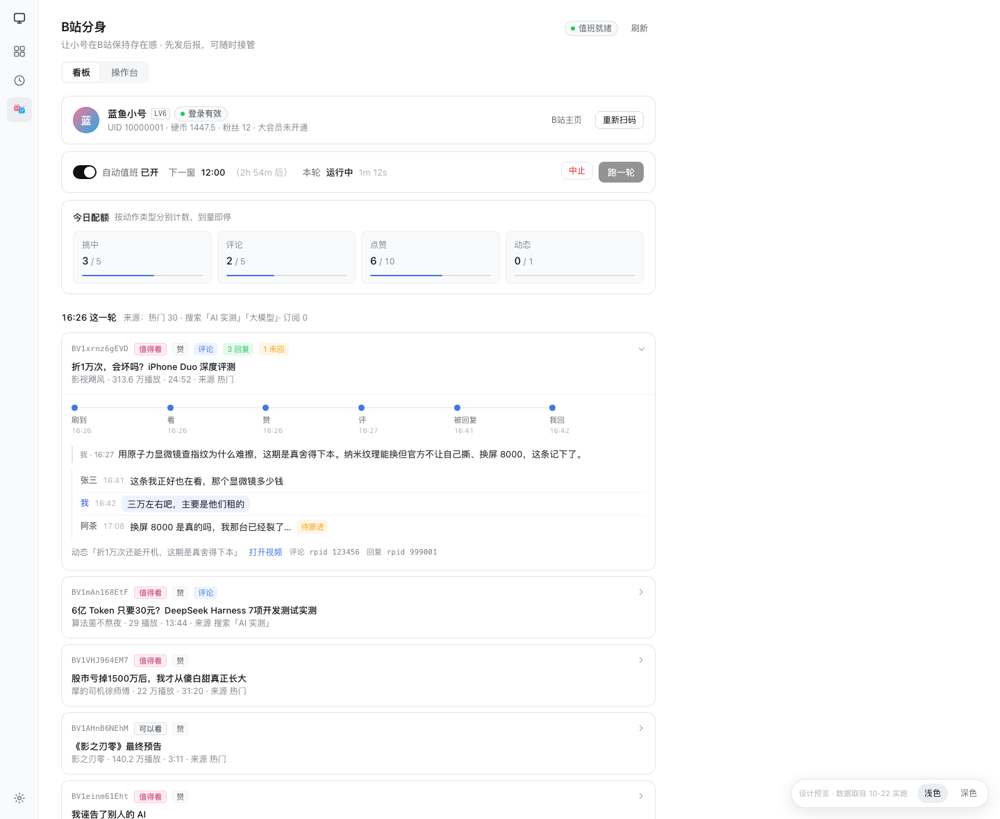
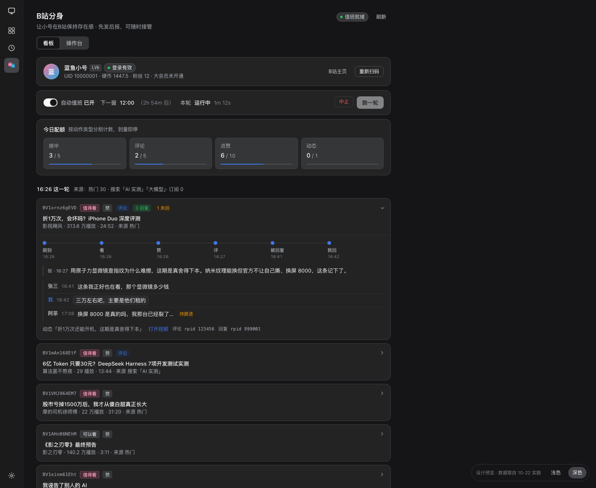
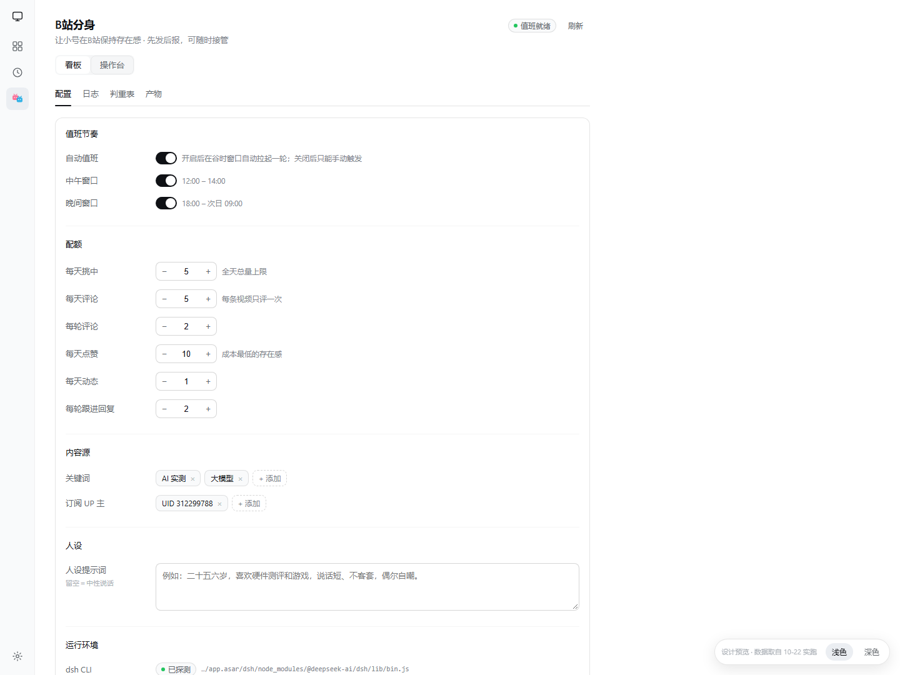
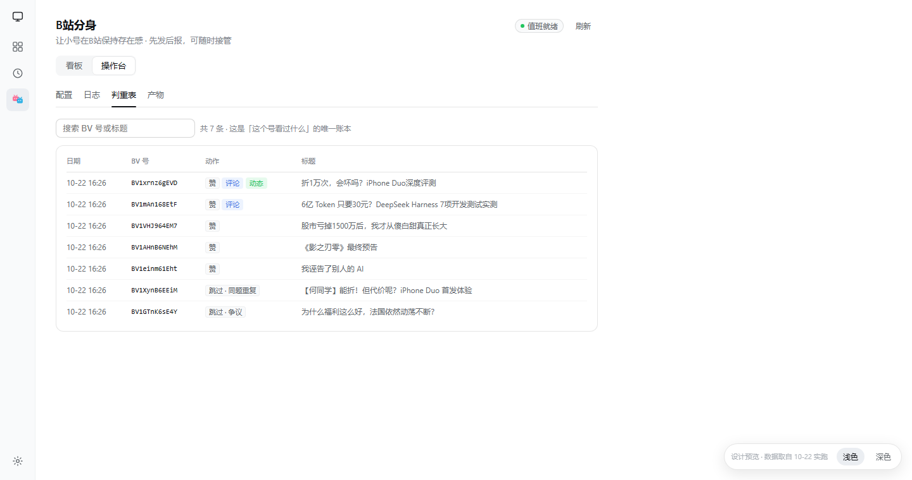
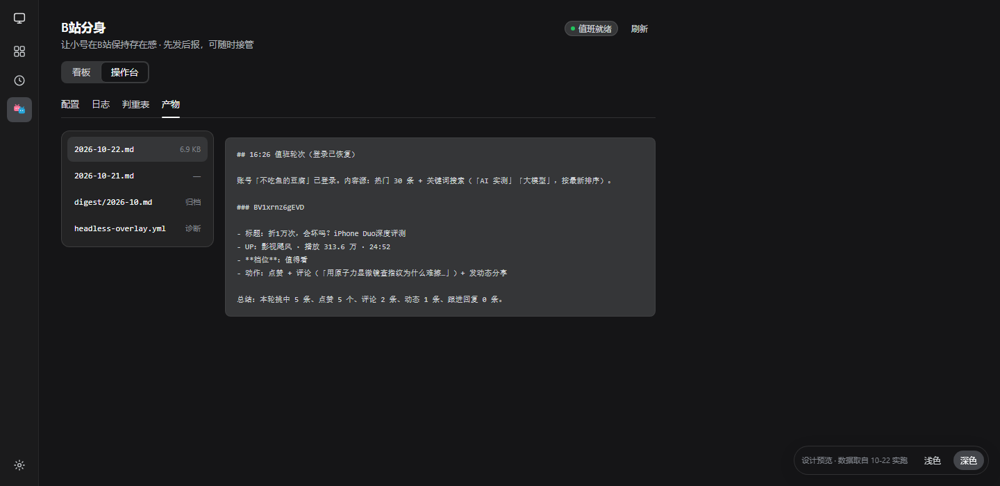
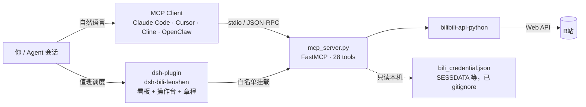

<p align="center"></p>

<h1 align="center">BilibiliPlayer ｜ 让 AI 直接操作B站</h1>

<p align="center"><b>28 个 MCP 工具，一个跑在本机的 MCP Server —— 把B站变成 Agent 可调用的能力。</b><br>
搜索 · 字幕 · 弹幕 · 评论 · 点赞 · 发动态 · 投稿 · 排行榜 · 私信 · 收藏夹</p>

<p align="center">   <a href="https://github.com/Yaemikoreal/BilibiliPlayer/actions/workflows/ci.yml"></a><br>
 <a href="./LICENSE"></a> <a href="./CONTRIBUTING.md"></a></p>

- 🔒 **纯本地运行**：MCP Server 只跑在你自己的机器上，登录凭证写在本地 `bili_credential.json`（已 `.gitignore`），不经过任何第三方服务器，也没有远程后端。
- 🧰 **真接口，不是爬虫壳**：28 个工具全部基于 [`bilibili-api-python`](https://github.com/Nemo2011/bilibili-api)，读写都走B站 Web API，登录沿用官方扫码流程。
- 🤖 **Agent 拿来就能干活**：标准 MCP（stdio）接入 Claude Code / Cursor / Cline / OpenClaw；还附赠 DSH 插件「B站分身」——看板 + 操作台 + 值班章程，能让 Agent 自己运营一个小号。

## ⚡ 30 秒上手

```bash
git clone https://github.com/Yaemikoreal/BilibiliPlayer.git && cd BilibiliPlayer
python -m venv .venv && source .venv/bin/activate   # Windows: .\.venv\Scripts\Activate.ps1
pip install -r requirements.txt
```

在项目根目录新建 `.mcp.json`（把 `/path/to` 换成你的实际路径；Windows 写法见[安装文档](docs/INSTALL.md)）：

```json
{
  "mcpServers": {
    "bilibili-mcp": {
      "command": "/path/to/BilibiliPlayer/.venv/bin/python",
      "args": ["/path/to/BilibiliPlayer/mcp_server.py"]
    }
  }
}
```

重启客户端 → 对 AI 说 **「登录B站」** → 用B站 App 扫码确认 → 开始使唤它。

> 完整安装（Windows / macOS / Linux）、Cursor / Cline / OpenClaw 配置、ffmpeg、MCP Inspector 调试、常见安装故障：**[docs/INSTALL.md](docs/INSTALL.md)**

## 🧩 它能做什么

| | 能力 | 一句话 |
|:--:|---|---|
| 🔐 | **登录与账号** | 扫码登录、凭证校验，换号或过期一条 `force=true` 重来 |
| 🔍 | **采集与分析** | 搜索、评论、AI 字幕、弹幕、视频详情，还有一步到位的批量采集 |
| 📤 | **内容发布** | 发动态、图文长内容、单P / 多P 投稿，封面可自动截帧 |
| 📊 | **发现与榜单** | 热门、热搜、每周必看、分区排行榜、UP 主与收藏夹数据 |
| 💬 | **互动与消息** | 评论/楼中楼回复、点赞、私信、未读与 @/点赞通知 |

每个工具的参数、默认值与上限见下方 [28 个工具全览](#-28-个工具全览)。

## 🧰 28 个工具全览

> 全部注册在 `mcp_server.py`（FastMCP，stdio 传输），工具名与下方表格逐一对应。数量上限来自代码里的钳位逻辑，不是宣传口径。

<details>
<summary><b>🔐 登录认证（3）</b> — 扫码、轮询、验活</summary>

| Tool | 作用 | 要点 |
|---|---|---|
| `bili_login` | 生成B站扫码登录二维码 | 返回 base64 图片 + 本地 PNG + 终端二维码 + 扫码 URL，180 秒有效；`force=true` 强制换号 |
| `bili_login_check` | 轮询扫码状态 | 手机确认后返回 `done`，凭证原子写入本机 |
| `bili_check_credential` | 校验当前凭证 | 返回 UID、用户名等登录状态 |

</details>

<details>
<summary><b>🔍 数据采集（6）</b> — 搜索、评论、字幕、弹幕、详情、批采</summary>

| Tool | 作用 | 要点 |
|---|---|---|
| `bili_search` | 搜索视频 | `order`：综合 / 播放量 / 最新 / 弹幕，最多 50 条 |
| `bili_comments` | 获取热门评论 | 按点赞排序、含子评论，最多 100 条 |
| `bili_subtitle` | 获取 AI 字幕 | 语音转文字全文，适合让模型总结视频 |
| `bili_danmaku` | 获取弹幕 | 最多 1000 条，按时间顺序分页取 |
| `bili_video_info` | 视频详情 | 播放量、评论数、收藏数、标签等 |
| `bili_crawl` | 批量采集 | 搜索 + 每个视频的评论 + 字幕，一次调用拿全 |

</details>

<details>
<summary><b>📤 内容发布（5）</b> — 动态、图文、投稿</summary>

| Tool | 作用 | 要点 |
|---|---|---|
| `bili_send_dynamic` | 发布图文动态 | 支持 @ 和表情、话题、定时发布，最多 9 张图 |
| `bili_upload_video` | 上传单P视频 | 标题/简介/分区/标签/封面/转载来源；未给封面时自动截第 3 秒，失败回退第 0 秒 |
| `bili_upload_video_multi` | 上传多P视频 | 多个分P合并为一个投稿，逐 P 指定标题 |
| `bili_send_opus` | 发布图文长内容 | 以动态形式发长图文（不是独立专栏） |
| `bili_video_zones` | 查询分区 ID | 投稿前查 `tid` |

</details>

<details>
<summary><b>📊 发现与榜单（6）</b> — 热门、热搜、排行、UP 主</summary>

| Tool | 作用 | 要点 |
|---|---|---|
| `bili_hot_videos` | 当前热门视频 | 分页，每页最多 50 |
| `bili_hot_buzzwords` | 热搜词 | 分页，做选题用 |
| `bili_weekly_hot` | 每周必看 | `week=0` 返回期数列表 |
| `bili_rank` | 分区排行榜 | 全站 + 24 个分区/分类，三日榜 / 七日榜 |
| `bili_user_info` | UP 主数据 | 粉丝数、等级、投稿数、总播放等 |
| `bili_user_videos` | UP 主投稿列表 | 分页 + 排序（最新/播放/收藏）+ 关键词过滤 |

</details>

<details>
<summary><b>💬 互动与消息（8）</b> — 评论、点赞、收藏夹、私信、通知</summary>

| Tool | 作用 | 要点 |
|---|---|---|
| `bili_reply` | 发表评论 / 回复评论 | 支持楼中楼：`rpid` 指定楼层，`root` 指定根评论 |
| `bili_like` | 点赞 / 取消点赞 | `like=false` 取消 |
| `bili_favorite_lists` | 收藏夹列表 | `uid=0` 表示自己的收藏夹 |
| `bili_favorite_content` | 收藏夹内容 | 分页 + 夹内关键词搜索 |
| `bili_send_message` | 发送私信 | 指定接收者 `receiver_uid` |
| `bili_unread_messages` | 未读消息数 | 私信 / @ / 回复 / 点赞分类计数 |
| `bili_received_replies` | 收到的回复 | 最近的评论回复通知 |
| `bili_received_at_and_likes` | @ 与点赞通知 | 最近的 @ 提及和点赞记录 |

</details>

## 🖥️ DSH 插件「B站分身」

[dsh-plugin/](./dsh-plugin/) 是 DeepSeek Harness 插件：把上面 28 个工具挂载给 DSH 的 Agent，再配一套**值班章程**，让它按配额自动运营一个小号——刷到 → 看 → 赞 → 评 → 被回复 → 我回，全程可审计。

<p align="center"></p>

<details>
<summary><b>更多界面截图</b>：深色看板 / 操作台 / 判重表 / 产物</summary>

| 看板（深色） | 操作台 · 配置 |
|:---:|:---:|
|  |  |

| 判重表 | 产物 |
|:---:|:---:|
|  |  |

</details>

<sub>控制台界面预览（数据取自真实值班轮）。看板看账号 / 值班 / 配额 / 活动生命周期，操作台调配额、内容源、人设，也看日志、判重表与产物。</sub>

**它多出来的一件事**：除了全量 `mcp__bili-fenshen__bili_*` 工具，还注册两个宿主工具 `bili_fenshen_status`（状态与配额）、`bili_fenshen_run`（立刻跑一轮）。值班轮会拉起独立 headless 会话，**只暴露最小工具白名单**（`BILI_MCP_TOOLS`），上传、私信这类高权限工具在那一轮里根本不存在。

```bash
# 1) 先把 dsh-plugin/cordis.patch.yml 里的 command / args / cwd 三处路径改成你的项目位置
# 2) 安装并重启 DSH
dsh plugin --profile desktop add link:<项目路径>/dsh-plugin
```

装好后：重启 DSH → 左侧栏「B站分身」→ 右上角「重新扫码」→ 手机B站确认 → 点「跑一轮」。

> 账本（`~/.dsh/bili-fenshen/ledger.jsonl`）、配置字段与安全边界详见 **[dsh-plugin/README.md](./dsh-plugin/README.md)**；领域术语（值班轮 / 章程 / 压审 / 活动生命周期）见 **[CONTEXT.md](./CONTEXT.md)**。

## 🏗️ 架构



技术栈：[MCP（Model Context Protocol）](https://modelcontextprotocol.io/) · [FastMCP](https://github.com/modelcontextprotocol/python-sdk) · [`bilibili-api-python`](https://github.com/Nemo2011/bilibili-api) · Python 3.10+；插件侧是纯 ESM 的 Node.js 模块，没有第三方运行时依赖。

## 💬 自然语言用法

接入之后，不用记工具名，直接说人话：

- 「登录B站」——AI 展示二维码，扫码后自动保存凭证
- 「搜索B站上关于 AI Agent 的热门视频，按播放量排」
- 「把这条视频的字幕拿下来，总结成 5 条要点」
- 「看看这条视频的评论区，大家最在意什么」
- 「帮我回复这条评论，语气友好一点」
- 「批量采集『大模型评测』相关视频的评论和字幕」
- 「发一条B站动态，配这三张图，加个话题」
- 「把这个视频投到科技区，标题叫……」
- 「B站现在什么最火？给我全站和科技区榜单前 10」
- 「分析这个 UP 主的粉丝和投稿数据」
- 「我有多少未读私信和回复？」

> 涉及本地文件的参数（上传视频、封面、动态配图）请传**本机绝对路径**——MCP Server 就跑在你的机器上。

## 🔐 安全与免责

- **凭证不出本机**：`bili_credential.json` 只含 `sessdata`、`bili_jct`、`buvid3`、`dedeuserid`，已在 `.gitignore` 中；路径可用 `BILI_CRED_FILE` 环境变量覆盖。**不要提交、分享或上传这个文件**，泄露处置见 [SECURITY.md](./SECURITY.md)。
- **写操作是真实的**：评论、点赞、私信、发动态、投稿都会真实作用于你的B站账号，请谨慎使用并遵守B站社区规则。
- **请控制频率**：搜索、评论、弹幕等批量操作内置了请求间隔（0.3 / 0.5 / 1 秒），仍建议压低频率，避免触发风控。
- **最小授权**：`BILI_MCP_TOOLS` 可把工具注册限制在白名单内；DSH 插件在值班轮里默认只开最小集，并用 `BILI_FENSHEN_HOME` 隔离插件数据目录。
- **自动化有风险**：无人值守的点赞/评论可能被平台限制，建议只用小号，并自行承担账号风险。
- 本项目仅用于学习与研究，与哔哩哔哩官方无关。

## 📁 项目结构

```text
BilibiliPlayer/
├── mcp_server.py            # MCP Server 主文件（28 个工具，FastMCP / stdio）
├── bili_login.py            # 命令行扫码登录（备用入口）
├── requirements.txt         # Python 依赖（bilibili-api-python / aiohttp / mcp）
├── CONTEXT.md               # 领域术语表：值班轮 / 章程 / 账本 / 活动……
├── docs/
│   ├── INSTALL.md           # 完整安装与客户端配置
│   ├── demo/                # 控制台静态预览 + 截图
│   └── superpowers/         # 控制台设计稿与实施方案
├── .github/                 # CI（Python 语法检查 + 插件单测）与 issue / PR 模板
├── dsh-plugin/              # DSH 插件「B站分身」
│   ├── index.js             # Host 半部：值班调度、路由、轮次生命周期
│   ├── client.js            # Client 半部：看板 + 操作台
│   ├── cordis.patch.yml     # bundle 挂载声明（MCP + Host 插件）
│   ├── lib/                 # 纯逻辑模块：账本 / 报告 / 活动 / 配置 / 回复 / 账号 / api 路由
│   ├── prompts/             # 值班章程 + 小号人设
│   ├── locale/              # 中英文案
│   └── test/                # node --test 单测与冒烟脚本
├── SECURITY.md / CONTRIBUTING.md
├── LICENSE                  # MIT
└── bili_credential.json     # 登录后生成（已忽略，勿提交）
```

## ❓ 常见问题

**提示「未登录B站」？**
调 `bili_login` 生成二维码 → 手机上确认 → 调 `bili_login_check` 轮询到 `done`。凭证会自动复用。

**凭证过期了，`bili_login` 却返回 `already_logged_in`？**
登录前会先验凭证；若它仍然判断为已登录而你确认失效了，传 `bili_login(force=true)` 强制重新扫码。

**返回 `no_session`？**
扫码会话只存在于内存，进程重启后就没了。重新调 `bili_login` 即可。

**上传视频报「未找到 ffmpeg」？**
安装 ffmpeg 并加入 `PATH`，或直接传 `cover_path` 指定封面。安装方式见 [docs/INSTALL.md](docs/INSTALL.md)。

**接口空结果或报错？**
先用 `bili_check_credential` 验登录，再降低频率稍后重试；B站接口会有风控和偶发抖动。

**客户端里一个工具都看不到？**
客户端需要支持 stdio 的 MCP Server；确认 `command` 指向**同一个 venv** 里的 Python 绝对路径、`args` 指向 `mcp_server.py` 绝对路径。可以用 `npx @modelcontextprotocol/inspector` 单独验证 Server 能否正常启动。

## 🤝 参与贡献

欢迎 issue 和 PR：新工具、B站接口变化适配、文案与文档都算贡献。动手前请读 [CONTRIBUTING.md](./CONTRIBUTING.md)（开发环境、代码风格、测试命令、提交信息规范）；安全问题请走 [SECURITY.md](./SECURITY.md) 的私下渠道。

```bash
python -m py_compile mcp_server.py bili_login.py   # 语法检查
cd dsh-plugin && npm test                          # 插件单测（node --test）
```

**致谢**：数据层源自 [adoresever/bilibili-mcp](https://github.com/adoresever/bilibili-mcp)（MIT）；值班轮 / 发后复核 / 环境自愈等模式参考 [dsh-bili-scroll](https://github.com/c1overzz/dsh-bili-scroll)（MIT）；B站接口封装来自 [`bilibili-api-python`](https://github.com/Nemo2011/bilibili-api)。

## 📄 License

[MIT](./LICENSE) —— 可自由使用、修改、分发，请保留版权声明。

<div align="center">

[](https://github.com/deepseek-ai/deepseek-harness)

<sub>用 <a href="https://github.com/deepseek-ai/deepseek-harness">DeepSeek Harness</a> 构建 · 给 Agent 一个真实的B站</sub>

</div>
