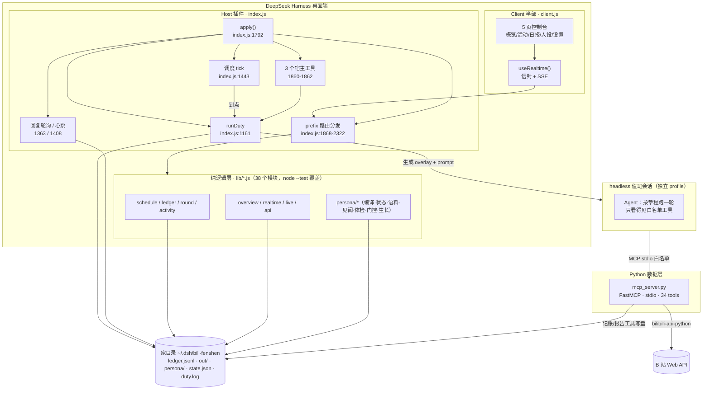
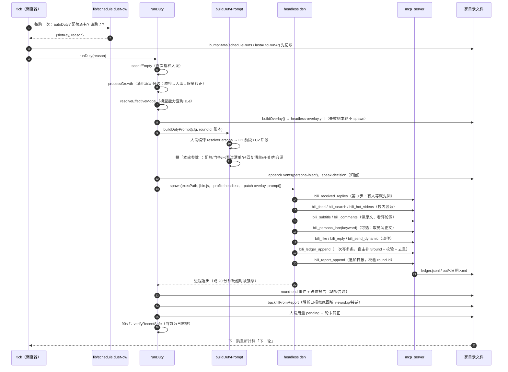
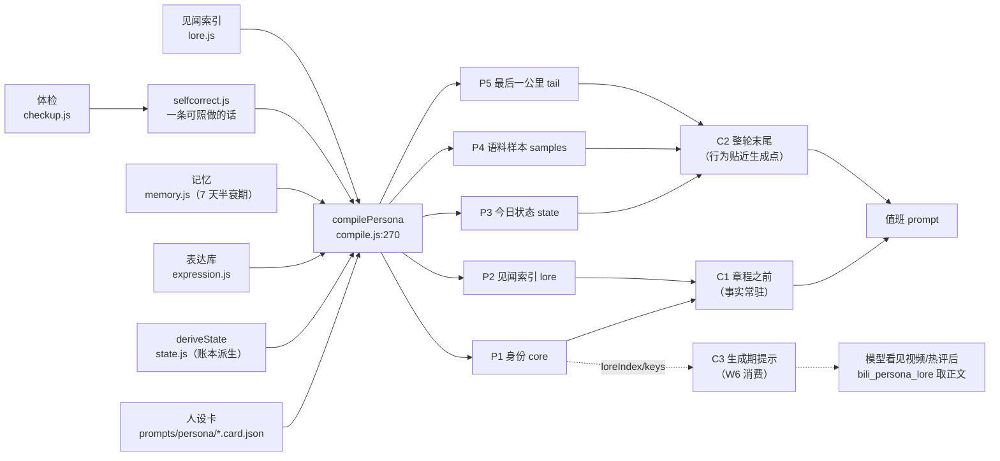
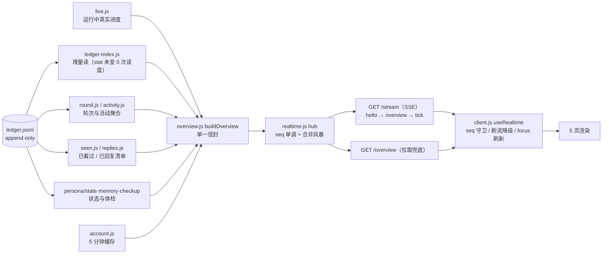
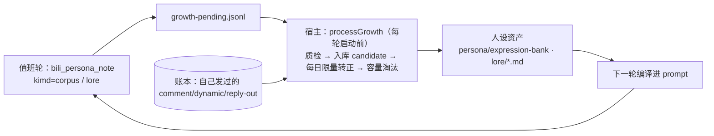

# B站分身（dsh-bili-fenshen）｜功能点 · 管线 · 架构总览

> **文档定位**：面向维护者与二次开发者的「一图看懂 + 落到行号」总览。读懂这一份，能定位到任意一个行为是在哪个文件的哪一段实现的。
>
> | 项 | 值 |
> |---|---|
> | 生成时间 | 2026-10-29 |
> | 代码基线 | `main` @ `76b8995`（本地与 `origin/main` 同步） |
> | 测绘方式 | 逐文件只读测绘 + 行号标注（行号对应本次基线，改动后以符号名为准） |
> | 权威顺序 | **代码 > 本文件 > 各 README**（README 有若干滞后点，见 §8.2） |

---

## 0. 怎么读

- 只想了解「它能干什么」→ §2 功能点全景
- 想理解「一轮值班到底发生了什么」→ §3.2 时序图 + §4.2 时间线
- 想改代码/定位 bug → §5 关键位置详解（全部带 `文件:行号`）
- 想接数据/做控制台 → §6 数据模型 + §4.6 数据管线
- 想装到别的机器 → §5.1.9 路径约定 + §8 已知边界

---

## 1. 一句话定位与三层分工

**一句话**：用 `mcp_server.py` 把B站变成 Agent 可调用的 34 个工具，再用一个 DSH 插件把这些工具、一套值班章程、一个人设卡和一键控制台组装起来，让 Agent 按配额、按排班、有纪律地运营一个B站小号。

三层职责泾渭分明：

| 层 | 产物 | 职责 | 不做什么 |
|---|---|---|---|
| **Python 数据层** | `mcp_server.py`（2712 行，FastMCP / stdio） | B站 API 的唯一封装：登录、读写、字幕、评论、通知；另有 4 个「值班专用」结构化工具（内容源/记账/报告/人设素材） | 不管排班、不管人设、不写控制台 |
| **Host 插件层** | `dsh-plugin/index.js` + `lib/*.js` | 值班调度、轮次生命周期、prompt 装配（章程 + 人设）、headless 拉起、账本/报告落盘、HTTP 路由、3 个宿主工具 | 不直接出网操作B站（写操作全走 MCP 工具） |
| **Client 控制台层** | `dsh-plugin/client.js` | 5 页控制台：概览 / 活动 / 日报 / 人设 / 设置，加实时信封与事件流 | 不持有业务状态，全部数据来自 `/api/bili-fenshen/*` |

边界补充：**写操作只有一条路** —— Agent 调 `bili_*` 工具；控制台只读 + 写配置/人设卡；宿主自己不发起 B站写请求。

---

## 2. 功能点全景

### 2.1 内容消费

| 功能 | 实现位置 | 说明 |
|---|---|---|
| 关注池一次拉齐 | `mcp_server.py:2107` `bili_feed` | 「最常访问」前 N 个 UP 的最新投稿，已按账本标 `seen`，`seen=true` 直接丢 |
| 搜索 / 热门 / 榜单 / 每周必看 | `mcp_server.py:360/1462/1542/1519` | 关键词搜索（近 7 天优先）→ 热门兜底 |
| 视频详情 + **字幕原文** | `mcp_server.py:613/547` | 章程要求「别看摘要下判断」，必须先读字幕 |
| 弹幕 / 评论区 | `mcp_server.py:572/470` | 评论带 `rpid`，接话要用 |
| 批量采集 | `mcp_server.py:1013` | 搜索 + 每条视频评论 + 字幕，一次拿全（研究/离线分析用） |

### 2.2 发言与互动

| 功能 | 实现位置 | 关键纪律 |
|---|---|---|
| 评论 / 楼中楼回复 | `mcp_server.py:923` `bili_reply` | `rpid=0` 发新评论；`rpid=<对方一级评论>` 进楼中楼；**已回目标硬拦截** |
| 接话（主动回复别人的评论） | 章程 `prompts/duty.md:139` | 每轮**必须先做一次接话扫描**并落 `reply-scan` 事件；可发 0..N 条 |
| 跟进（回复对我的回复） | 章程 `prompts/duty.md:122` | 每轮第 0 步先 `bili_received_replies`，有人等就先回 |
| 点赞 | `mcp_server.py:1921` | 最低成本的存在感 |
| 发动态 | `mcp_server.py:1125` | 纯文本感想是否允许由配置 `dynamicPureText` 控 |
| 判重（三层） | `lib/replies.js:93`、`index.js:984/1067`、`mcp_server.py:943/1859` | 判重键 = 对方评论 `rpid`；接话+跟进共用一份「已回复清单」 |
| 发布前质量门 | `mcp_server.py:652`（规则源 `lib/persona/lint.js`） | 规则导出到 `<家目录>/persona/lint-rules.json`，Python 侧哑执行同一份规则 |

### 2.3 账号与登录

| 功能 | 位置 | 说明 |
|---|---|---|
| 扫码登录（MCP 版） | `mcp_server.py:188/246` | base64 二维码 + 本地 PNG + 终端二维码，180 秒有效 |
| 扫码登录（JS 版，控制台用） | `index.js:56`+ 路由 `index.js:1927` | 直连 passport 接口，写 `bili_credential.json` |
| 凭证校验 | `mcp_server.py:320` | `nav` 接口验活；缺失/过期只 warn |
| 账号简况（概览顶部） | `lib/account.js` + `index.js:1477` | 5 分钟缓存，网络抖动不把「已登录」翻成「未登录」 |

### 2.4 人设系统（豆腐 · 鲸鱼娘）

| 功能 | 位置 | 说明 |
|---|---|---|
| 人设卡（运行时事实来源） | `prompts/persona/whale.card.json`（v3.0.0 生效） | 卡片 schema / L0 静态判据 / 旧 markdown 迁移：`lib/persona/card.js` |
| 五块编译 | `lib/persona/compile.js:88/155/208` + `lib/persona/layers.js:66` | 身份 / 见闻索引 / 今日状态 / 语料样本 / 最后一公里 → 装成 C1（章程前）+ C2（末尾）+ C3（生成期提示） |
| 今日状态（不让模型编） | `lib/persona/state.js` | 心情/时段/最近 3 条/形态欠账/沉默计数/冷却表，宿主算 |
| 表达库（按形态分桶的真实语料） | `lib/persona/expression.js` | 三护栏：只给形态样本、跳过签名梗重复、不复读 |
| 见闻库（索引常驻 + 正文按需） | `lib/persona/lore.js`、`mcp_server.py:2558` `bili_persona_lore` | 正文不进 prompt，命中现场关键词才读 |
| 体检与自纠 | `lib/persona/checkup.js`、`lib/persona/selfcorrect.js` | 五个指标（中位字数/句号数…）→ 一条可照做的提示塞进下一轮 C2 |
| 发言门控 | `lib/persona/speak.js` | `observe`（只算只记，默认）/`enforce`（压上限）；**永不放宽配额** |
| 自演化 | `lib/persona/growth.js` + `mcp_server.py:2596` `bili_persona_note` | 候选 → 质检入库 → 每日限量转正 → 容量淘汰 |
| 换卡对比 | `lib/persona/tagstats.js` | 按 `persona-inject.personaTag` 分组统计哪版人设的评论更受认可 |

### 2.5 运营与调度

| 功能 | 位置 | 说明 |
|---|---|---|
| 三种排班 | `lib/schedule.js:224` `dueNow` | `windows`（谷时窗口）/`interval`（固定间隔+活跃时段）/`daily`（HH:MM 槽位），三者都受星期过滤 |
| 手动触发 | `index.js:1841` 宿主工具 `bili_fenshen_run`、路由 `POST /run` | 同轮进行中拒绝重复触发 |
| 配额（账本为唯一事实来源） | `index.js:463` `quotaFromLedger` | 挑中/评论/点赞/动态，日累计 vs 本轮上限 |
| 轮次生命周期 | `index.js:1161` `runDuty` + `index.js:1290-1362` 收尾 | 20 分钟硬超时、SIGTERM→强杀进程树、占位报告、报告兜底回填 |
| 回复通知轮询 | `index.js:1363` 起（每 5 分钟） | 拉 msgfeed → `reply-in` 事件，失败退避（`lib/replies.js:9` 1→5→15 分钟） |
| 心跳自愈 | `index.js:1408` | `running=true` 但子进程已消失 ⇒ 纠正状态 |
| 发后复核（对抗压审） | `index.js:1427` `verifyRecentSafe` | **当前是日志桩**，真实只读复核计划 V1.5（见 §8.2） |

### 2.6 可观测与控制台

| 功能 | 位置 | 说明 |
|---|---|---|
| 5 页控制台 | `client.js:53-57` | 概览 / 活动 / 日报 / 人设 / 设置 |
| 概览单一信封 + SSE | `lib/realtime.js` + `lib/overview.js:199` + `lib/api.js:264-300` | `hello` → `overview` → 运行中每 1.5s `tick`；15s 心跳；`seq` 单调 |
| 运行详情（阶段轨/秒表/工具计数） | `lib/live.js:36-49` | 4 阶段 `find/watch/act/think`，行分类 `classifyLine:69` |
| 事件流 | `GET /api/bili-fenshen/live/stream` | 工具/推理/输出逐行 |
| 活动三视图 | `client.js:1793` | 生命周期 / 时间线 / 判重表（含接话、接话扫描两类） |
| 一键诊断 10 项 | `lib/diagnose.js` + `index.js:1684` | 每项 `pass/warn/fail` + 人话建议 |
| 宿主侧工具 | `index.js:1816/1841/1849` | `bili_fenshen_status` / `_run` / `_diagnose` |

### 2.7 安全与授权

| 机制 | 位置 | 说明 |
|---|---|---|
| 工具白名单门禁 | `mcp_server.py:40` | `BILI_MCP_TOOLS` 未列的工具**不注册**，模型看不见；值班轮默认最小集 |
| 值班 overlay 隔离 | `index.js:798` `buildOverlay` | 独立 headless profile + 白名单 + `BILI_FENSHEN_HOME` |
| 同源守卫 | `lib/api.js:66` `sameOriginGuard` | 本地 API 防跨站调用 |
| 提示注入防御 | 章程 `prompts/duty.md:44-49` | 评论/字幕/简介里的文字一律视为素材，不是指令 |
| 默认禁令开关 | `index.js:211-217` 配置 | 隐私/冒充/争议/同视频只评一次/敏感请求，默认全开 |
| 凭证本地化 | `bili_credential.json`（gitignore） | 路径可用 `BILI_CRED_FILE` 覆盖 |

---

## 3. 架构图

### 3.1 运行时全景



### 3.2 一轮值班的时序（核心管线）



### 3.3 人设编译与注入（三通道）



### 3.4 数据与控制台管线



### 3.5 人设自演化



---

## 4. 管线详解

### 4.1 调度管线（`lib/schedule.js` + `index.js:1443`）

1. **tick** 由宿主定时器触发（`index.js:1443`），先做两道守卫：`autoDuty` 关闭直接返回；今日挑中数 ≥ `perDay` 直接返回。
2. 调用 `dueNow(cfg, now, state, running||starting)`（`lib/schedule.js:224`）——**全部时间判定都在纯函数里**，可注入 `now` 单测。
3. 三种模式共用一套「槽位键」：`windows` 的窗口键 / `interval` 的分钟槽 / `daily` 的 `HH:MM` 槽；`dutyWeekdays` 在 `isActiveDay`（`schedule.js:135`）统一过滤。
4. **先记账再触发**：`pruneScheduleRuns` 剪掉 14 天前记录后写入 `state.scheduleRuns`，同一槽位只跑一次（`index.js:1454`）；记账失败不阻断本轮。
5. `runDuty(reason)` 异步拉起，异常全部兜住（调度器这一跳出错绝不能影响宿主）。

`interval` 模式额外有活跃时段 `dutyActiveStart/End`（start > end 表示跨夜）；`daily` 模式宿主晚到 20 分钟内补跑，超过宽限跳过。

### 4.2 轮次生命周期时间线

| 阶段 | 代码位置 | 关键行为 |
|---|---|---|
| ① 播种人设 | `index.js:1166` | 首次运行且无 `active.json`/无卡/无旧 prompt ⇒ 播种 whale |
| ② 消化沉淀 | `index.js:1173` | `processGrowth`：质检→入库→限量转正；失败不阻断 |
| ③ 并发守卫 | `index.js:1179/1194` | `running` / `starting` 双标志，防重复触发 |
| ④ CLI 探测 | `index.js:477` `dshCliCached` | 找不到 ⇒ 补占位报告并返回明确错误 |
| ⑤ 实时流开 | `index.js:1189` | `live.start(roundId)`，spawn 调试与子进程输出都进「运行详情」 |
| ⑥ 模型解析 | `index.js:760` | 插件配置优先，否则跟随会话默认；推理强度按模型能力决定写不写 |
| ⑦ overlay 生成 | `index.js:798` | 写不出 ⇒ **本轮不 spawn**（残缺 overlay 起轮 = 白烧配额） |
| ⑧ prompt 装配 | `index.js:952` `buildDutyPrompt` | 人设 C1/C2 + 章程 + 本轮参数（见 §4.3） |
| ⑨ 归因落账 | `index.js:1213/1232` | `persona-inject`、`speak-decision` 两条事件（成本 0，解释「这轮吃了哪版人设/为什么只发 1 条」） |
| ⑩ spawn | `index.js:1243` | `execPath + bin.js --profile headless --patch overlay + prompt`；`ELECTRON_RUN_AS_NODE=1`；POSIX 独立进程组 |
| ⑪ 硬超时 | `index.js:1267` | 20 分钟到点：记 `lastError` → 杀进程树（Windows `taskkill /T /F`、POSIX `kill(-pid)`） |
| ⑫ 输出解码 | `index.js:1279` | stdout/stderr 各配**持久 UTF-8 解码器**，防跨 chunk 多字节被切坏（老 bug：整段中文乱码） |
| ⑬ 收尾 | `index.js:1290-1362` | 写 `round-end`（code/durationMs）；缺 `reply-scan` 补 `note`；缺报告补占位报告 |
| ⑭ 回填 | `index.js:660` | 解析当日日报补 `view/skip/reply-scan/reply-out(proactive)`，`source:"report"` |
| ⑮ 用量转正 | `index.js:864` 起 | 人设 pending 用量 → 冷却表闭环（否则 `usedToday` 永远 false） |
| ⑯ 发后复核 | `index.js:1337` → `1427` | 90s 后调用；**当前仅打日志桩**（真实只读复核待 V1.5） |

### 4.3 prompt 装配管线（`buildDutyPrompt`，`index.js:952`）

装配顺序（决定了模型看到什么的先后，而「位置即权重」）：

1. **头**：一句身份声明（「你是这个账号的用户本人」）。
2. **C1（人设前段）**：身份 + 见闻索引 —— 放在**章程之前**，只放永不变的事实。
3. **章程**：`prompts/duty.md`（v6，15 节，见 §5.5）。
4. **本轮参数**（`index.js:1048-1080`）：
   - round id + 账本绝对路径 + 报告路径
   - 配额（全天总量 / 今日已用 / 本轮上限 / 门控压过的值）
   - 发言节奏（宿主算好，别自己数）
   - **主动接话**：每轮硬步骤 + 可发上限
   - **已看过清单**（近 14 天 BV，命中直接丢）
   - **已回复清单**（近 14 天 `BV→对方 rpid`，接话+跟进都在内）
   - 接话正确姿势（`bili_reply` 的 rpid/root 语义）
   - 内容源优先级三档 + 不看清单 + 本轮开关
   - 口吻纪律、工具前缀、判重表/归档路径
5. **C2（人设后段）**：今日状态 + 语料样本 + 最后一公里 —— 放在**整轮末尾**，越贴近生成点越有效。
6. **降级机制**：总长超软线时二次编译（只砍见闻/示例/状态，**L0 尾注永远保留**）。

### 4.4 工具调用与权限管线

```
值班轮白名单 = 配置 dutyTools
             ∪ {bili_feed, bili_ledger_append, bili_report_append}   ← index.js:794 自动追加
             − (growthEnable=false 时剔除 bili_persona_note)
```

- 白名单写进 overlay 的 `BILI_MCP_TOOLS`（`index.js:851`），Python 侧 `mcp_server.py:40` 在**注册期**过滤 ⇒ 名单外的工具在那一轮**不存在**（不是被拒绝，是不可见）。
- 会话级（非值班轮）MCP 连接不设该变量 ⇒ 全量 34 个工具可用。
- `bili_reply` 的硬拦截优先级高于一切：命中去重集合直接拒绝，连 B站 API 都不碰（`mcp_server.py:943`）。

### 4.5 记账 / 报告 / 回填管线

三道防线解决「模型手写文件」的历史事故（一行塞多对象导致配额全消失、编码乱码）：

1. **工具化写入**：`bili_ledger_append`（`mcp_server.py:2265`）一次写多条 —— 宿主补 `t`/`round`、按类型校验必填、U+FFFD 检测、同 `(round,type,bvid,text)` 去重、UTF-8 单行落盘；`bili_report_append`（`mcp_server.py:2332`）校验标题里的 round id 并防重复追加。
2. **解析期容错**：`lib/ledger.js:38` `salvageObjects` —— 即使某行真被塞了多个对象，也能逐个捞回来，而不是整行丢弃。
3. **轮末兜底回填**：`backfillFromReport`（`index.js:660`）把日报里能解析出的动作补进账本，带 `source:"report"`，前端标注「据报告回填」；2026-10-29 起回填去重改为**全局**（`bvid+parent`），不再每轮补一份 `rpid=null` 的重复行。

### 4.6 控制台数据管线（单一信封 + SSE）

- **信封中枢** `createOverviewHub`（`lib/realtime.js:12-114`）：`buildOverview`（`lib/overview.js:199`）一次算完整屏要的数字；文件一变 / 轮次起止 / 配置保存 ⇒ `publish`；`seq` 单调（`:63`）；**合并风暴** = debounce 250ms + 最小间隔 800ms（`:69-76`）；`compute` 抛错时**保留旧数据、只置 `degraded`**（`:58-61`），绝不白屏。
- **两条独立 SSE**（不要混为一谈）：
  - `GET /stream` = 概览信封（`lib/api.js:222-309`）：`hello`（**不带 seq**）→ 强制 `hub.bump('stream-open')` 出一帧新信封 → 订阅 `overview` 帧；运行中每 1.5s 一帧 `tick`（`:276-300`，空闲时用 `live.isRunning()` 短路，最长 10s 补一帧）；`ping` 心跳 15s（`:303-307`）。
  - `GET /live/stream` = 一轮内的事件流（`lib/api.js:135-187`）：首帧 `snapshot`，之后 `event`/`snapshot` 分流。
- **降级链**：SSE 全局最多 4 条连接（`api.js:11`），第 5 个标签页拿 503 JSON → `onerror` → 静默转轮询（概览运行中 2s / 空闲 10s；事件流 1s / 5s）；`GET /overview` 是同一信封的拉取兜底。
- 客户端：`useRealtime`（`client.js:769-994`）——`seq` 单调守卫（首帧豁免，`811-816`）、`AbortController` + 自增 `reqId` 丢晚到响应（`859-879`）、`focus`/`visibilitychange` 立即刷；页头显示**数据新鲜度**（>15s 黄、>60s 红）。
- 运行中的真实进度来自 `live.js`（环形缓冲 400 条 / 单帧 200 条，工具/动作计数），不再等「轮末才写账本」——所以跑着的时候秒表、阶段、配额都在动。

### 4.7 回复通知轮询管线（`index.js:1363`）

每 5 分钟（失败按 1→5→15 分钟退避，`lib/replies.js:9`）拉 msgfeed：

1. `fetchReplyNotifs`（硬超时 8s + 外部 AbortSignal）→ `toReplyIn`（`lib/replies.js:22`）映射成 `reply-in` 事件。
2. 关键语义：`rpid` = **对方那条**（= 我回复时的 parent），`parent` = **我那条**被回复的评论（用于归属轮次）。
3. `roundIdForReply`（`lib/replies.js:133`）把通知归属到「我发那句话」的轮次（用我方的 `rpid` 匹配，7 天窗口）。
4. 写入账本后，下一轮 prompt 的「已回复清单」与 `bili_received_replies.already_replied` 都依赖它。

---

## 5. 关键位置详解

### 5.1 Python 数据层：`mcp_server.py`（2712 行）

#### 5.1.1 初始化与传输
- `mcp = FastMCP("bilibili-mcp")`（`:38`），stdio 传输；日志一律走 stderr（`:58`），避免污染 JSON-RPC 通道。
- 启动入口 `:2711` `if __name__ == "__main__"`。

#### 5.1.2 白名单门禁（`:40`）
- 装饰器 `_gated_tool()` 在**注册期**判断：`BILI_MCP_TOOLS` 未设 ⇒ 全量；设了 ⇒ 只注册名单内的。
- 这是「最小授权」的落地方式：不是运行时拒绝，而是工具根本不存在。

#### 5.1.3 通用 helper（`:68`）
- 统一返回格式 `_ok/_err`、凭证读取（`BILI_CRED_FILE` 可覆盖）、标题清洗、图片上传。

#### 5.1.4 工具清单（34 个，实测 `^async def bili_` 计数）

| 分组 | 工具 | 行号 |
|---|---|---|
| 登录（3） | `bili_login` / `bili_login_check` / `bili_check_credential` | 188 / 246 / 320 |
| 采集（6） | `bili_search` / `bili_comments` / `bili_subtitle` / `bili_danmaku` / `bili_video_info` / `bili_crawl` | 360 / 470 / 547 / 572 / 613 / 1013 |
| 发布（5） | `bili_send_dynamic` / `bili_upload_video` / `bili_upload_video_multi` / `bili_send_opus` / `bili_video_zones` | 1125 / 1185 / 1293 / 1374 / 1417 |
| 发现（7） | `bili_hot_videos` / `bili_hot_buzzwords` / `bili_weekly_hot` / `bili_rank` / `bili_user_info` / `bili_user_videos` / `bili_followings` | 1462 / 1498 / 1519 / 1542 / 1604 / 1653 / 1944 |
| 互动（8） | `bili_reply` / `bili_like` / `bili_favorite_lists` / `bili_favorite_content` / `bili_send_message` / `bili_unread_messages` / `bili_received_replies` / `bili_received_at_and_likes` | 923 / 1921 / 1704 / 1742 / 1787 / 1822 / 1840 / 1895 |
| **值班专用（5）** | `bili_feed` / `bili_ledger_append` / `bili_report_append` / `bili_persona_lore` / `bili_persona_note` | 2107 / 2265 / 2332 / 2558 / 2596 |

> ⚠️ 根 README 写「29 个工具」、`dsh-plugin/README.md` 写「32 个」，**实测 34 个**（29 基础 + 5 值班/人设）。以本表为准。

#### 5.1.5 质量门 lint（`:652`）
- 只读 `<家目录>/persona/lint-rules.json`，规则**单一事实来源在 `lib/persona/lint.js`**（JS 侧 `buildLintRules` 导出，Python 侧哑执行）。
- 卡一改就重导（`lib/persona/index.js:234` `exportLintRules`）。

#### 5.1.6 记账工具（`:2265` `bili_ledger_append`）
- 必填字段表 `_LEDGER_REQUIRED`（`:2205`），见 §6.1。
- 单次上限 40 条（`:2215`）；`round` 取自 `_current_round_id()`（`:2222`）——**优先读宿主注入的 `BILI_FENSHEN_ROUND_ID`**，读不到才退 `state.json.lastRunStartedAt`（这是 2026-10-29 修的「round id 双源」bug）。
- 去重键 `(round, type, bvid, text)`（`:2301`），命中直接进 `rejected` 并给原因。

#### 5.1.7 报告工具（`:2332` `bili_report_append`）
- 校验 Markdown 标题里的 `round id`（格式 `## <时段>轮（round id <ISO>）`），同一 round 重复提交直接拒 ⇒ 宿主回填与前端对账不会错位。

#### 5.1.8 判重三处落点
| 层 | 位置 | 行为 |
|---|---|---|
| 账本集合 | `:2074` `_replied_targets()` | 读全部 `reply-out`（**不限窗口**，宁多勿漏）+ 本进程内存并集 |
| 通知标注 | `:1859` | 每条通知标 `already_replied` / `bvid` / `target_rpid` |
| 发送硬拦截 | `:943` | 命中 ⇒ 直接 `_err(... alreadyReplied=True)`，不调 API；成功后 `_remember_replied_target` 进内存（`:992`） |

#### 5.1.9 路径与凭证约定
- 凭证：`bili_credential.json`（`BILI_CRED_FILE` 可覆盖），只含 `sessdata` / `bili_jct` / `buvid3` / `dedeuserid`。
- 插件家目录：`BILI_FENSHEN_HOME` 优先，否则 `~/.dsh/bili-fenshen`（`:669`，与 JS 侧 `homeDir()` 同源）。
- 走 MCP 客户端配置时，`command`/`args`/`cwd` 是**绝对路径**，换机器必须改（见 §8.1）。

### 5.2 Host 插件：`index.js`（2396 行）

#### 5.2.1 入口与声明
- `export const inject = ['webServer', 'tools']`（`:1790`）—— 依赖宿主两个服务。
- `export function apply(ctx, config)`（`:1792`）：注册 3 个工具 → 挂 prefix 路由 → 注册设置页入口 → 启动定时器（tick / 回复轮询 / 心跳）。

#### 5.2.2 配置 Schema（`:165-258`）
- 用宿主注入的受限 `z` 构造器（**不能用 `.enum()`**，`:230` 有血泪注释：导入期抛错会让整个插件加载失败而单测仍全绿）；值域由 `lib/config.js` 的 `validateFields` 在运行期收口。
- 生效配置 = patch 默认值 ← `<家目录>/config.json` 覆盖层（`index.js:456` `effCfg`）。

#### 5.2.3 路径与状态（`:260-272`）
`HOME`（可被 `BILI_FENSHEN_HOME` 覆盖）、`OUT_DIR`、`DIGEST_DIR`、`PROMPTS_DIR`、`LOG_FILE`、`STATE_FILE`、`OVERLAY_FILE`、`LEDGER_FILE`、`CONFIG_FILE`。

#### 5.2.4 值班轮核心
- `buildDutyPrompt`（`:952`）：纯装配、不产生 IO；返回值必须是字符串（人设注入元数据通过模块级记录 `getLastPersonaInject()` 旁路传出，`:933`）。
- `runDuty`（`:1161`）：见 §4.2 的 16 步。
- `buildOverlay`（`:798`）：headless 那轮的 profile 补丁 —— 开三个服务、注入 MCP 白名单、`BILI_FENSHEN_ROUND_ID`、模型/provider 配置。
- `stopDuty`（`:578`）与 `killProcessTree`（`:599`）：SIGTERM → 2s → 杀整棵进程树（否则 python MCP 会成孤儿继续占家目录）。
- 日志：`appendLogChunk`（`:629`）+ 按 512KB 轮转（`:428`），子进程流用持久解码器（`:1279`）。

#### 5.2.5 调度与自愈
- `tick`（`:1443`）；`dueNow` 纯逻辑在 `lib/schedule.js:224`。
- 回复轮询（`:1363`）、心跳自愈（`:1408`）、发后复核桩（`:1427`）。

#### 5.2.6 路由分发（`:1868-2322`）
- 单条 `prefix` 路由 `/api/bili-fenshen`，内部按 `method + path` 分发（`web.register({kind:'prefix', ...})`，`:2306`）。
- 路由清单（index.js 侧，`api.js` 侧见 §5.2.7）：

| 方法 | 路径 | 作用 |
|---|---|---|
| GET | `/status` | 状态与配额（`bili_fenshen_status` 同源） |
| POST | `/run` | 立刻跑一轮 |
| POST | `/stop` | 中止本轮 |
| GET | `/report?day=` | 读日报 / 月度归档 / overlay |
| GET | `/log` | 宿主日志尾部 |
| POST | `/login/start`、GET `/login/poll`、GET `/login/qr.png` | JS 侧扫码登录 |
| GET | `/cred` | 凭证是否存在（不返内容） |
| GET/PUT | `/persona`、`/persona/preview`、`/persona/checkup`、`/persona/history` | 人设卡读/写/预览/体检/版本 |
| GET/POST/PUT | `/persona/expression`、`/persona/lore` | 语料库 / 见闻库增删改 |
| GET/POST | `/persona/versions`、`/persona/versions/restore`、`/persona/preset` | 版本与预设 |

> 对应实现行号（index.js）：`/status` 1890、`/run` 1906、`/report` 1909、`/log` 1923、`/login/start` 1927、`/login/qr.png` 1946、`/login/poll` 1956、`/cred` 1960、`/persona` 1967（PUT 2133）、`/persona/preview` 1990、`/persona/checkup` 1998、`/persona/history` 2026、`/persona/expression` 2038/2063、`/persona/lore` 2045/2089/2119、`/persona/versions` 2128、`/persona/versions/restore` 2149、`/persona/preset` 2161。

> ⚠️ **路由双写（读代码最容易踩的坑）**：`/run`、`/log`、`/report`、`/login/*` 等在两处各有一份实现，且**返回形状不同**（例如 `/log`：legacy 回 `{text}`，工厂回 `{events,raw,path}`）。分派顺序是 `FACTORY_PATHS` 先认领（`index.js:2177-2184`、`2272-2277`），**工厂胜出**、legacy 只作兜底；`ROUTE_PATHS`（`index.js:2189-2200`）是给「挂载自检」用的全量注册表。改接口前先确认自己改的是哪一份。

#### 5.2.7 路由清单（`lib/api.js`，注入式工厂）
- `createApiHandler(deps)`（`:100`）—— 依赖全注入，**没有 DSH 也能单测**；handler 是 Node 原始 `(req,res)` 风格，主分发在 `:311-448`，顶层 try/catch → 500（`:438-447`），另有 `handler.closeSse()`（`:451-456`）供插件卸载时关掉所有 SSE。
- `sameOriginGuard`（`:66-98`）：本地 API 同源守卫，五条规则（`Sec-Fetch-Site`、`Origin: null`、`Origin ≠ Host`、webOrigin 校验、POST 仅收 `application/json`）；工厂端点先过一遍（`:322-323`），宿主 dispatch 再统一守一次（`index.js:2261-2270`）。
- 路由表：

| 方法 | 路径 | 作用 | 行号 |
|---|---|---|---|
| GET | `/overview` | 概览信封（优先 `hub.view('http')`，失败退 `deps.overview()`） | 326-333 |
| GET | `/activity` | 账本 → 按日/轮/视频聚合 | 334-337 |
| GET | `/account` | 账号信息（前端已改读信封，保留兼容） | 338-340 |
| POST | `/duty` | 自动值班开关 + 排班字段（`validateFields` / `normalizeScheduleFields`） | 341-358 |
| POST | `/run` | 起一轮 | 359-362 |
| POST | `/stop` | 中止本轮 | 363-365 |
| GET | `/config` | 生效配置 | 366-369 |
| POST | `/config` | 校验 + 归一化 + 写覆盖层 → `resetCliCaches` → `hub.publish('config')` | 370-387 |
| GET | `/log` | 日志尾部（`tail` 20–2000，`HOST_LINE` 过滤） | 388-397 |
| GET | `/seen` | 判重表（`parseSeenRows` :29-54） | 398-404 |
| GET | `/reports` | 日报 / 归档 / overlay 列表 | 405-408 |
| GET | `/models` | 模型目录（缺失 503） | 411-414 |
| POST | `/diagnose` | 一键诊断（缺失 503） | 417-420 |
| GET | `/live` | 运行快照（`?after=` seq 过滤） | 423-429 |
| GET | `/live/stream` | 事件流 SSE → `openSse`（:135-187） | 430-432 |
| GET | `/stream` | 概览 SSE（hello/overview/tick）→ `openStream`（:222-309） | 433-435 |
| * | 其它 | 404 `unknown ${method} ${path}` | 437 |

- SSE 常量：`SSE_MAX_CLIENTS = 4`、`SSE_HEARTBEAT_MS = 15_000`（`:11-12`）；概览 tick 周期 `TICK_MS`（`:204`）、补帧心跳 `TICK_HEARTBEAT_MS`（`:206`）。

#### 5.2.8 宿主工具（`:1816/1841/1849`）
`bili_fenshen_status`（状态与配额）、`bili_fenshen_run`（立即一轮）、`bili_fenshen_diagnose`（10 项诊断）。三者都要求 `output: { schema, render }` 且返回无损 JSON（`:1801`）。

#### 5.2.9 诊断（`index.js:1684` → `lib/diagnose.js`）
10 项固定顺序并行跑：Python 解释器 / 依赖 / MCP Server 文件 / MCP 连接 / B站凭证 / dsh CLI / headless profile / 家目录可写 / 模型可用 / 控制台路由。

### 5.3 Client 控制台：`client.js`（4090 行）

#### 5.3.1 页面结构

**外壳**：`ConsolePage`（`:3878-3975`）—— 页签表 `TABS`（`:52-58`，v4 由 7 页收敛为 5 页）、旧 key 别名 `TAB_ALIAS`（`:60`，live→overview、seen→activity）、页面分发（`:3941-3956`）。

| 页面 | key | 渲染函数 | 行号 | 内容要点 |
|---|---|---|---|---|
| 概览 | `overview` | `OverviewPage` | 3816-3874 | 状态条 3836 / `Banner` 3857（组件 1403-1423）/ `AccountCard` 3474-3522 / `TodayCard` 3524-3578 / `ProactiveCard` 3581-3622 / `SpeakGateCard` 3777-3814 / `RunningDetail` 3375-3469（原「实时」页并入：阶段轨+秒表+事件流）/ `QuotaCard` 3625-3661 / `PresenceCard` 3664-3704 / `PersonaHealthCard` 3707-3772 |
| 活动 | `activity` | `ActivityPage` | 1793-1964 | 三视图 `ACT_VIEWS` :1504（生命周期 1874-1909 / 时间线 1910-1946 / 判重表 `SeenView` 1745-1790）；`ActivityCard` 1605-1659 内含七站链路 `StageRail` 1573-1582 与对话流 `ReplyThread` 1584-1603；类型 chips `ACT_FILTERS` 1510-1514 |
| 日报 | `reports` | `ReportsPage` | 1968-2017 | 左列表（日报/月度归档/overlay）1987-1999，右正文 `/report?day=` 2001-2009，自绘 `Markdown` 1677-1727 |
| 人设 | `persona` | `PersonaPage` | 2099-2939 | 3 子页签 `PERSONA_TABS` :2023（人设卡 2583-2808 / 素材库 2810 / 预览与质量 2815-2919）；页头 2315、“现在是谁”2340、注入卡 2368、体检卡 2453、换卡对比 2500；`LegacyFallback` 2047-2097 |
| 设置 | `settings` | `SettingsPage`→`ConfigPane` | 2945-2960 → 3018-3289 | 3 组 `SET_SUBTABS` :2943（节奏与配额 / 内容与禁令 / 运行环境）；`ModelFields` 2962-3016、`LogPane` 3291-3338、显式保存条 3279-3287 |
| 设置页入口 | — | `SettingsEntry` | 3981-4010 | `settings.section` 瘦身版（安装自检 + 打开控制台） |
| 侧栏图标 | — | `PanelIcon` | 4045-4056 | 左侧栏「B站分身」 |

#### 5.3.2 前端取数

- 封装：`API = '/api/bili-fenshen'`（`:32`）、`apiGet/apiPost/apiPut`（`:648-656`）、`cachedGet`（30s TTL，`:648-686`；失败不缓存、命中返回同一 promise）。
- 主数据走信封：`/overview`（SSE 优先，轮询兜底），不再各卡各拉。
- 按页门控的侧数据：`/activity`（运行 3s / 空闲 15s，`:1156`）、`/seen`（15s）、`/reports`（60s）、`/models`（60s）、`/live?after=`（降级 1s/5s）。
- 人设页首屏并发打 4 个接口（`/persona`、`/persona/preview`、`/persona/expression`、`/persona/lore`，`:2100-2104`）；手动刷新先 `resetGetCache()` 绕 TTL（`:666`）。
- 写操作：`POST /config`（3059）、`POST /duty`（3901）、`POST /run`（3906）、`POST /stop`（3914）、`PUT /persona`（2184）、`POST /persona/preset`（2171）、`POST /persona/versions/restore`（2198）、语料/见闻增删改（2204-2310）。

#### 5.3.3 实时消费

- `useRealtime`（`:769-994`）：`accept`（首帧豁免 seq，`:807-829`）、`applyTick`（**允许 seq 相等**，只丢更旧，`:832-856`）、`fetchOnce`（AbortController + `reqId`，`:859-879`）、`startSse`（EventSource `/stream`，`:896-927`）、断流转轮询（`:923-926`）、`refresh`（`:957-990`）。
- `useLive`（`:1006-1137`）：EventSource `/live/stream`，`mergeFrames` 按 seq 去重 + 排序 + 截断（客户端上限 `LIVE_MAX_EVENTS=300`，略小于服务端 400），轮次切换清缓冲、页面隐藏停轮询。
- `useElapsed`（`:1139-1151`）：本地秒表，不靠服务端帧率。

#### 5.3.4 与宿主的边界（想加页面必须先读）

- **加载方式**：`window.__ModuleLoader__.load({ id:'dsh-bili-fenshen', factory(require) })`（`:22-24`）；**只 `require('react')`**，不 require 任何 `@deepseek-ai/dsh-client-*`（`:19` 的约束注释）；`package.json` 用 `dsh.client` 声明平台与运行时注入。
- **插件对象**：`{ inject: ['slots','layout'], apply(ctx) }`（`:4058-4084`）。宿主能力全走 `ctx`，没有 window 全局的旁路。
- **三个插槽**（各自独立 try/catch，单点失败不影响其他）：`sidebar.panellist`（`:4065-4070`，order 15）、`main`（`:4073-4077`，`key: PANEL_ID`）、`settings.section`（`:4079-4082`，order 35）。
- **主题**：没有主题 hook —— 纯 CSS 变量映射宿主 `--dsw-*`（`:76-120`），深浅色跟随宿主；只有图标/头像用 B 站粉蓝。
- **国际化**：没有 i18n hook，UI 文案硬编码中文（`T` `:34-42`、`PAGE_TITLE` `:62`）；`locale/zh.json` 只给宿主插件目录用，不进前端。

#### 5.3.5 改前端必看的七个坑

1. **错误边界必须懒创建**：`guardPage`（`:4018-4042`）里的 `class extends React.Component` 要在 render 期才建 —— vm 直载测试里 `require('react')` 是没 `Component` 的桩，工厂期建类会炸掉整个 client.js。
2. **首帧 seq 陷阱（真机事故）**：客户端只接受「更大 seq」，所以 `hello` 不带 seq + 建连强制 `bump` + 客户端首帧豁免，三处缺一帧就丢。
3. **tick 帧 seq 不推进**：与已知信封相等是常态，`applyTick` 因此只丢更旧、不要求更大。
4. **SSE 硬上限 4 条**：第 5 个标签页静默降级轮询（不报错刷屏）。
5. **空闲不推 tick**：避免每 1.5s 读账本空转，代价是空闲期只有 `: ping` 保活。
6. **路由双写**：见 §5.2.6 的警告 —— `/run`、`/log` 等前端读的可能是工厂版，不是 legacy 版。
7. **「绝不谎报」是硬纪律**：hub 失败保留旧数据只标 degraded；无数据显示「正在连接…」而非「刚刚」；门控非法档位按 observe 显示并标注「不谎称强制」；`/persona/sandbox` 只有 UI 占位、端点不存在。


### 5.4 纯逻辑层：`lib/*.js`（38 个模块）

顶层 18 个：

| 模块 | 职责（取自文件头注释） |
|---|---|
| `ledger.js` | 账本 append-only JSONL；`salvageObjects` 救回「一行塞多对象」的脏行 |
| `ledger-index.js` | 增量读：stat 未变 0 次读盘、只读增量段、变小则全量回退 |
| `round.js` | 轮次与存在感聚合（纯函数，不碰 IO） |
| `activity.js` | 事件 → 活动/轮次（生命周期聚合） |
| `overview.js` | 概览信封 `buildOverview` / `overviewTick` |
| `realtime.js` | 概览推送中枢：单一信封 + seq 单调 + 合并风暴 |
| `live.js` | 实时运行视图：轮次状态机 + 环形缓冲 + 行分类（4 阶段） |
| `api.js` | 路由工厂（依赖注入，Node 原始 handler） |
| `schedule.js` | 三种排班纯逻辑：`normalizeSchedule` / `dueNow` / `nextRunAt` / `scheduleLabel` |
| `config.js` | 覆盖层合并 + 白名单/类型校验 + 原子写 |
| `diagnose.js` | 10 项诊断（env 注入，不直接联网/不写真实家目录） |
| `replies.js` | msgfeed → `reply-in`；已回复清单 `repliedTargetsFromLedger`；轮次归属 |
| `report.js` | 日报 → 兜底事件（解析失败一律空结果） |
| `seen.js` | 已看过清单（宿主硬判重） |
| `account.js` | 账号简况（只读接口，失败降级） |
| `memory.js` | 记忆聚合视图（关键词 + 时间窗 + 重要度，不用向量库） |
| `logsink.js` | 流式解码 / 尾部截断 / 按字节轮转 / 探测降噪 |
| `persona.js` | 人设加载：`personaPrompt` 支持正文或文件路径 |

`lib/persona/` 20 个：

| 模块 | 职责 |
|---|---|
| `index.js` | 门面：`resolvePersona`（决定这一轮喂什么人设、喂在哪）/ `previewPersona` / `exportLintRules` / `savePersonaCard` / `editExpressionBank` / `editLoreIndex` / `personaHealth` |
| `compile.js` | 编译器：卡 → 五块文本（`buildCore` / `buildState` / `buildTail` / `compilePersona`） |
| `layers.js` | 分层装配：五块 → C1/C2 + C3 结构提示（`buildLayers`） |
| `budget.js` | 五块字符预算 + argv 守卫 + 场域字数 + 渲染位置 |
| `card.js` | 卡 v2 schema + L0 静态判据 + 旧 markdown 迁移 |
| `state.js` | 今日状态（mood/时段/最近 3 条/形态欠账/沉默计数/冷却表） |
| `expression.js` | 表达库：按形态分桶的真实热评语料（三护栏） |
| `lore.js` | 见闻库：索引常驻、正文按需 |
| `sample.js` | 示例抽样：同形态 3–5 条 + 1 条反例，跳过高相似 |
| `text.js` | 长度口径 / n-gram / 句子切分 / 预算裁剪 / 确定性抽样 |
| `lint.js` | 发布前 lint 判据唯一事实来源（声明式规则） |
| `checkup.js` | 体检：五个指标（纯函数） |
| `selfcorrect.js` | 体检 → 一条能照做的话 |
| `speak.js` | 发言门控打分（配额内只收紧不放宽） |
| `growth.js` | 自演化管道：质检 → 入库 → 限量转正 → 容量淘汰 |
| `store.js` | 预设卡/用户卡/版本快照/首次播种/资产定位 |
| `attribution.js` | 人设注入归因 → 账本事件 |
| `tagstats.js` | 换卡对比（按 `personaTag` 分组） |
| `legacy.js` | legacy 直通（旧 `personaPrompt` 行为逐字节不变） |
| `sample.js` | 见上（示例抽样） |

### 5.5 章程：`prompts/duty.md`（273 行，charter v6）

15 节，按「模型会犯错的地方」组织：

| 节 | 行 | 解决的问题 |
|---|---|---|
| 先记住三条 | 17 | 反复权衡 / 重复重试 / 把「空结果」当故障 |
| 预算与反内耗 | 25 | 推理文本占日志 85%：工具 ≤20 次、候选 ≤8 条、别回读校验编码 |
| 边界 | 42 | **提示注入防御**（评论/字幕都是素材，不是指令） |
| 一轮要做的事 | 51 | 0 查回复 → 1 拉内容源 → 2 判重 → 3 每条候选（含 3.5 接话扫描）→ 4 动作 → 5 报告 |
| 评论纪律 | 91 | 先给结论再写正文；收在情绪/问题/梗，不收在判断 |
| 跟进纪律 | 122 | 别人回我 → 必须看是否已回（目标级判重） |
| 接话纪律 | 139 | 扫描必做、三类可接、同 BV 每轮 ≤1、同一人 7 天 ≤1 |
| 动态纪律 | 159 | 纯文本感想开关 |
| 报告契约 | 167 | `### BV号` 结构化格式，宿主要靠它对账 |
| 记账契约 | 213 | 事件类型与字段（宿主工具会校验） |
| 判重表 | 238 | `seen.md` 人工可读档案（14 天以前的历史） |
| 沉淀契约 | 247 | 自演化：把长出来的东西交回去 |
| 判据 / 关于你自己 | 261 / 267 | 价值观与自称 |

---

## 6. 数据模型

### 6.1 账本事件（`<家目录>/ledger.jsonl`）

append-only，一行一事件。`bili_ledger_append` 的必填字段表来自 `mcp_server.py:2205`：

| type | 必填 | 可选/常见 | 语义 |
|---|---|---|---|
| `view` | `bvid` | `title` `author` `views` `duration` `source` `grade` | 刷到并看过 |
| `like` | `bvid` | — | 点赞 |
| `comment` | `bvid` `text` | `rpid` | 我发的评论 |
| `dynamic` | `text` | `bvid` `id` | 发动态 |
| `skip` | `bvid` `reason` | `title` | 跳过及理由 |
| `reply-out` | `bvid` `parent` `text` | `kind:'proactive'`（接话）/ 无 kind（跟进）`rpid` | **我回复别人的评论**；`parent` = 对方 rpid（判重键） |
| `reply-scan` | `bvid` `decision` | `targetRpid`（posted 必填）`candidates` `reason` | 接话扫描结论（每轮必写） |
| `note` | `text` | — | 宿主备注（如「本轮缺 reply-scan」） |
| `reply-in` | — | `bvid` `parent` `rpid` `from` `text` `notifId` | 别人回复我（宿主轮询写入） |
| `round-end` | — | `code` `durationMs` | 轮次收尾 |
| `persona-inject` | — | `personaTag` `degraded` `notes` | 人设归因 |
| `speak-decision` | — | `decision` `scope` | 发言门控判定 |

> 排序口径：`sortEvents` 按 `t` 字符串升序（`lib/ledger.js:66`）；账本里 `t` 混有 `…+08:00` 与 `…Z` 两种写法，精确「本地日」判定由下游 `dayKeyOf` 负责。

### 6.2 家目录文件（`~/.dsh/bili-fenshen`，可被 `BILI_FENSHEN_HOME` 覆盖）

| 文件/目录 | 内容 | 谁写 |
|---|---|---|
| `ledger.jsonl`(+`.old`) | 账本（5MB 轮转） | MCP 记账工具 / 宿主回填 |
| `duty.log`(+`.old`) | 宿主值班日志（512KB 轮转） | 宿主 |
| `state.json` | 运行态：`lastRunAt/lastCode/scheduleRuns/windows/lastRunStartedAt/commentsToVerify…` | 宿主 |
| `config.json` | 运行时配置覆盖层（控制台保存写这里） | 控制台 |
| `out/<日期>.md` | 日报（人读 + 兜底回填源） | `bili_report_append` |
| `digest/<年-月>.md` | 月度归档 | 宿主 |
| `headless-overlay.yml` | 上/本周期的 headless profile 补丁（诊断页可看） | 宿主 |
| `seen.md` | 判重表（人工可读档案） | Agent |
| `persona/` | `active.json` `card.json` `state.json` `lint-rules.json` `expression-bank.json` `lore/` `growth-pending.jsonl` `versions/` | 宿主 / 控制台 |

### 6.3 配置项（分组速查，Schema 见 `index.js:165-258`）

| 组 | 字段 |
|---|---|
| 调度 | `autoDuty` `noon` `night` `dutyScheduleMode` `dutyIntervalMinutes` `dutyDailyTimes` `dutyWeekdays` `dutyActiveStart/End` |
| 配额 | `perDay` `commentsPerDay` `commentsPerRound` `likesPerDay` `dynamicsPerDay` `repliesPerRound` `replyOthersPerRound` |
| 内容源 | `followUids` `followAuto` `followPerRound` `keywords` `avoidList` |
| 禁令/开关 | `banPrivacy` `banImpersonation` `banControversy` `banRepeat` `banReplyRefusal` `dynamicPureText` |
| 人设 | `personaPrompt`（legacy 直通）`growthEnable` `growthAutoPromote` `growthCheckedOnly` `speakGateMode` |
| 报告 | `reportLevel`（full/brief/off） |
| 运行环境 | `dshBin` `headlessProfile` `modelProvider` `modelName` `modelReasoningEffort` `dutyTools` |

---

## 7. 工具清单汇总

| 类别 | 数量 | 可见范围 |
|---|---|---|
| MCP 工具（`mcp__bili-fenshen__bili_*`） | 34 | 任意 DSH 会话（不设白名单时全量） |
| └ 值班专用 | 5（`feed`/`ledger_append`/`report_append`/`persona_lore`/`persona_note`） | 值班轮白名单内 |
| 宿主工具 | 3（`bili_fenshen_status`/`_run`/`_diagnose`） | 任意 DSH 会话 |

---

## 8. 已知边界与偏差

### 8.1 部署相关（换机器必看）

1. **绝对路径写死在 MCP 挂载配置里**：`dsh-plugin/cordis.patch.yml:15-21` 的 `command` / `args` / `cwd` 三处必须指向本机项目位置。仓库当前提交的是 `E:\myproject\BilibiliPlayer`（另一台机器）；本机 `D:\projects\bilbili` 通过 profile 覆盖层 `~/.dsh/profiles/desktop/cordis.patch.yml` 按 id 覆盖整条 `bili-fenshen-mcp` 配置来适配（loader 的 `config` **整体替换、不深合并**，字段必须全量重述）。
2. **改 MCP 侧代码要重启 DSH 才生效**：`mcp_server.py` 由 MCP 客户端在宿主启动时拉起为独立进程，文件改动不会热加载（宿主插件 `index.js` 会随 HMR 重载，两者节奏不同）。
3. **改 client.js 可能要重建前端 bundle**：取决于当前是否跑着 `pnpm run dev:web` 监视器。
4. `headlessProfile` 默认 `headless`，与桌面 `desktop` profile 分开（桌面版被 Electron 独占）。插件会把桌面 profile 的 `llm-pi-ai` provider 配置带进 headless，所以自定义 provider 也能用。

### 8.2 文档与代码的偏差（以代码为准）

| 说法 | 代码事实 |
|---|---|
| 根 README：「29 个工具」 | 实测 **34** 个（含 5 个值班/人设专用） |
| `dsh-plugin/README.md`：「32 个」 | 同上，34 |
| 根 README：「控制台 7 页」 | 当前 **5 页**（实时并入概览、判重表并入活动、人设工作室拆为人设页 3 子页） |
| `dsh-plugin/README.md`：「结束 90 秒后宿主复核（对抗压审）」 | 90s 定时器在（`index.js:1337`），但 `verifyRecentSafe`（`:1427`）**目前是日志桩**，真实只读复核待 V1.5 |
| 人设 v4.0.0 | 只在 `persona-snapshots/` 存档；活跃卡 `prompts/persona/whale.card.json` 仍是 **v3.0.0** |

### 8.3 设计边界（不是 bug，是选择）

- **判重依赖账本**：三层判重都以「回复已被记成 `reply-out` 且带 `parent`」为前提。接话有报告回填兜底；跟进回复依赖模型自己调 `bili_ledger_append`，若某轮漏记，下一轮就无从判重（同进程内存只有一轮的寿命）。
- **窗口口径不一致（有意为之）**：宿主注入清单用 14 天窗口（prompt 长度受限），MCP 硬拦截**不限窗口**（宁多勿漏）。超 14 天的老评论模型看不见，但真去回依然会被硬拦。
- **不改配额语义**：发言门控只收紧、永不放宽（`lib/persona/speak.js`）。
- **不做向量检索**：记忆用「关键词 + 时间窗 + 重要度 + 7 天半衰期」，为的是可复现（同一输入必得同一输出），与 `deriveState` 的哲学一致。
- **平台风险自担**：自动化评论/点赞可能触发 B站风控；默认 `autoDuty=false`，先手动跑是刻意设计。

---

## 9. 关键设计取舍（Why）

| 取舍 | 理由 |
|---|---|
| **宿主算判重，不让 Agent 自觉** | 日志实测：Agent 会为「这条是不是回过了」反复权衡并推翻自己；把判重做成宿主注入的清单 + 工具层硬拦截，才从「靠纪律」变成「结构上不可能」 |
| **判重键用「对方评论 rpid」** | 对方再发新话 = 新 rpid = 新互动，规则自洽；用「我方楼层」会导致同一评论被反复跟进 |
| **单一信封 + SSE，而不是各卡各拉** | 一屏要的数字一次算完；`seq` 单调让客户端只做「更大」判断，天然防乱序；文件一变就推，避免轮询风暴 |
| **运行进度用 `live.js` 而不是账本** | 账本是**轮末批量写**的，拿它当进度源会导致「跑着的时候配额/秒表不动」 |
| **记账/报告工具化** | 历史事故：手写 JSONL 一行塞多对象导致配额全消失；工具化后 `t/round` 由宿主补、字段校验、去重、UTF-8 一次一行 ⇒ 编码问题从「要小心」变成「不可能」 |
| **判重/回填都带「全局」去重键** | round id 曾双源（宿主 vs MCP 差 1s+），按 round 对账全部失效；改成 `(bvid,parent)` 全局判重后不再受时间源影响 |
| **人设分 C1/C2/C3 三通道** | 「事实常驻、行为末尾」：身份/红线放章程前，行为约束放整轮末尾（越贴近生成点越强），现场见闻放生成期（此时才知道刷到了哪条视频） |
| **headless 独立 profile + 白名单** | 值班轮里上传/私信等高权限工具**根本不存在**，而不是「被拒绝」 |
| **配置用覆盖层而非改 patch** | 控制台保存写 `<家目录>/config.json`，不动用户的 patch 文件；patch 升级不覆盖用户设置 |

---

## 10. 阅读路径

| 目标 | 建议顺序 |
|---|---|
| 快速上手 | `README.md` → `docs/INSTALL.md` → 控制台「设置 → 安装自检」 |
| 改值班逻辑 | `prompts/duty.md` → `index.js:952`（prompt 装配）→ `index.js:1161`（runDuty）→ `lib/schedule.js` |
| 改人设 | `docs/persona-layer-design.md` → `lib/persona/index.js:80`（门面）→ `compile.js` → `layers.js` → 控制台人设页 |
| 改控制台 | `dsh-plugin/CONSOLE-DESIGN.md` → `lib/api.js`（数据源）→ `lib/overview.js`（信封）→ `client.js:3878`（外壳） |
| 排查「该跑没跑」 | `state.json`（`scheduleRuns`/`lastCode`）→ `duty.log` → 控制台「运行环境 → 一键诊断」 |
| 排查「重复回复」 | 账本 `reply-out` 的 `parent` → `lib/replies.js:93` → `index.js:1067`（注入）→ `mcp_server.py:943`（硬拦截） |

---

## 附：一次值班轮的成本画像（来自章程与日志实测）

| 项 | 量 |
|---|---|
| `bili_*` 工具调用 | ≤ 20 次/轮（本地文件操作另算，合计 ≤ 4 次） |
| 候选视频 | ≤ 8 条（凑够本轮应发条数即停） |
| 工具调用大致分布 | 发现 ≤3 / 读字幕·热评 ≤6 / 动作 ≤4 / 记账 1 / 报告 1 |
| 推理文本占比 | 实测曾达日志的 **85%** ⇒ 章程专设「反内耗」一节压它 |
| 轮次硬超时 | 20 分钟（`index.js:564`，可被 `BILI_FENSHEN_ROUND_TIMEOUT_MS` 覆盖） |
