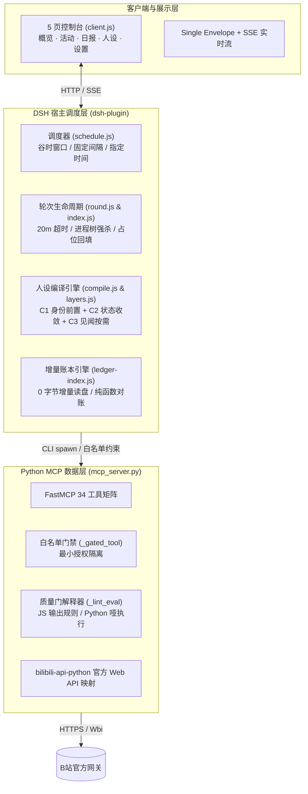
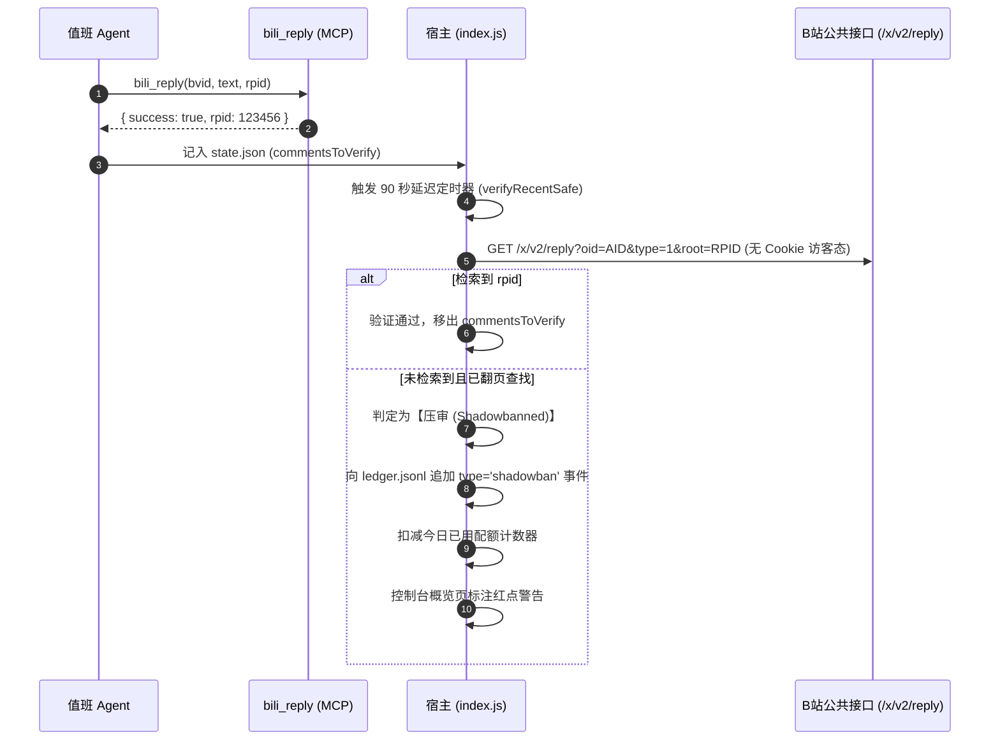
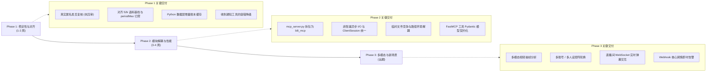

# BilibiliPlayer（bilibili-mcp & dsh-bili-fenshen）
# 架构优化、功能改良与能力拓展技术白皮书

> **文档代号**：`SPEC-2026-10-29-EVOLUTION`  
> **基线版本**：`main` @ `76b8995` ｜ DSH 插件 `v0.7.0` / MCP Server `34 工具集`  
> **面向对象**：核心维护者、架构师、自动化运维及二次开发者  
> **权威顺序**：`代码 > ARCHITECTURE.md > 本白皮书 > README.md`

---

## 0. 目录

- [一、 现状审视与原有设计理念回顾](#一-现状审视与原有设计理念回顾)
- [二、 亟需改良的核心功能痛点（Defects & Incomplete Features）](#二-亟需改良的核心功能痛点defects--incomplete-features)
  - [2.1 抗“压审”（隐性屏蔽）的发后复核引擎落地](#21-抗压审隐性屏蔽的发后复核引擎落地)
  - [2.2 人设系统与 52,464 条全量语料基线全面对齐](#22-人设系统与-52464-条全量语料基线全面对齐)
  - [2.3 Python 数据层全表扫描与 I/O 阻塞治理](#23-python-数据层全表扫描与-io-阻塞治理)
  - [2.4 消息通知与轻量互动工具的容错降级重构](#24-消息通知与轻量互动工具的容错降级重构)
- [三、 功能需要拓展的技术方向（Feature Expansions）](#三-功能需要拓展的技术方向feature-expansions)
  - [3.1 多模态视觉理解：解开“无字幕视频强制跳过”的束缚](#31-多模态视觉理解解开无字幕视频强制跳过的束缚)
  - [3.2 多账号 / 多人设分身矩阵与轮换体系](#32-多账号--多人设分身矩阵与轮换体系)
  - [3.3 B 站直播间 WebSocket 实时弹幕交互监听](#33-b-站直播间-websocket-实时弹幕交互监听)
  - [3.4 高价值互动与风控阻断的 Webhook 即时推送](#34-高价值互动与风控阻断的-webhook-即时推送)
- [四、 代码工程化与架构重构指南（Refactoring & Optimization）](#四-代码工程化与架构重构指南refactoring--optimization)
  - [4.1 单体巨石文件解耦：从 `mcp_server.py` 到 `bili_mcp` 包](#41-单体巨石文件解耦从-mcp_serverpy-到-bili_mcp-包)
  - [4.2 异步事件循环净化：消除阻塞性同步文件 I/O 与会话泄漏](#42-异步事件循环净化消除阻塞性同步文件-io-与会话泄漏)
  - [4.3 并发竞争规避：临时文件安全与原子化保障](#43-并发竞争规避临时文件安全与原子化保障)
  - [4.4 强契约化改造：接入 Pydantic 与 FastMCP 类型自省](#44-强契约化改造接入-pydantic-与-fastmcp-类型自省)
  - [4.5 前端控制台组件化：`client.js` 分层解耦](#45-前端控制台组件化clientjs-分层解耦)
- [五、 阶段演进路线与实施里程碑（Roadmap）](#五-阶段演进路线与实施里程碑roadmap)

---

## 一、 现状审视与原有设计理念回顾

本项目由两个核心子系统构成：**Python MCP 数据层**（[`mcp_server.py`](file:///D:/projects/bilbili/mcp_server.py)）与 **DSH 宿主运营插件**（[`dsh-plugin/index.js`](file:///D:/projects/bilbili/dsh-plugin/index.js)）。



### 1.1 核心设计哲学
1. **纯本地与零依赖泄露**：
   - 凭证存储于本地 [`bili_credential.json`](file:///D:/projects/bilbili/bili_credential.json)，不引入第三方中转服务器；
   - 严禁向外部传输会话 Cookie。
2. **三层严格分工**：
   - **数据层**只管与 B 站 API 对接和执行哑规则，不干预排班与人设策略；
   - **宿主层**掌管生命周期、Prompt 装配与对账审计，不直接出网写 B 站；
   - **控制台层**纯只读展示，严禁绕过 Agent 发起写操作。
3. **结构化杜绝内耗**：
   - 历史经验表明：依靠 LLM 自主记忆和自律去重会导致大量的 Prompt 浪费与推理内耗；
   - 系统贯彻“**结构上杜绝违规**”理念：三层硬判重（账本清单注入 + 工具返回标注 + 最终调用拦截）、工具化记账防乱码（[`bili_ledger_append`](file:///D:/projects/bilbili/mcp_server.py#L2265)）。
4. **活人感与反 AI 味**：
   - 不装真人、不编造事实、不向人类透露系统 Prompt；
   - 追求自然对话：短句、表情润滑、消除书面化总结腔、无空泛捧场。

---

## 二、 亟需改良的核心功能痛点（Defects & Incomplete Features）

### 2.1 抗“压审”（隐性屏蔽）的发后复核引擎落地

#### 2.1.1 现状与危害
- **现状代码**：在 [`dsh-plugin/index.js#L1427-L1435`](file:///D:/projects/bilbili/dsh-plugin/index.js#L1427-L1435) 中：
  ```javascript
  const verifyRecentSafe = async (why) => {
    try {
      const st = readJson(STATE_FILE, {})
      const lastComments = st.commentsToVerify || []
      if (!lastComments.length) return
      log(`复核桩（${why}）：待核 ${lastComments.length} 条（V1.5 接入真实复核）`)
    } catch { /* 兜住 */ }
  }
  ```
  该机制在设计上是核心的“先发后报”基石，但代码实现目前仅为**打印占位桩**。
- **严重危害**：B 站对自动化运营账号极易实行隐性降权（评论接口返回成功 `rpid`，但仅发布者本人可见，公共评论区完全不展示）。分身以为动作完成，计入每日配额，但实际上沦为幽灵评论，严重干扰运营质量评估。

#### 2.1.2 落地实现设计
建立无凭证只读探测链路：在每轮结束 90 秒后，通过免登录 Web 接口检查目标评论是否存在。



#### 2.1.3 具体改造代码实施
在 [`dsh-plugin/lib/replies.js`](file:///D:/projects/bilbili/dsh-plugin/lib/replies.js) 新增公开探测函数：
```javascript
export async function verifyCommentPublicly(oid, rpid, fetchImpl = fetch) {
  const url = `https://api.bilibili.com/x/v2/reply?oid=${oid}&type=1&sort=0&nohot=1&pn=1&ps=20`
  try {
    const res = await fetchImpl(url, {
      headers: {
        'User-Agent': 'Mozilla/5.0 (Windows NT 10.0; Win64; x64) AppleWebKit/537.36',
        'Referer': 'https://www.bilibili.com/'
      }
    })
    const data = await res.json()
    const replies = data?.data?.replies || []
    return replies.some(r => Number(r.rpid) === Number(rpid))
  } catch (e) {
    return null // 网络错误返回 null，不误判
  }
}
```

---

### 2.2 人设系统与 52,464 条全量语料基线全面对齐

#### 2.2.1 矛盾现状
1. **句号阈值不一致**：
   - 语料调研结论指出活人感必须消除句号；[`whale.card.json`](file:///D:/projects/bilbili/dsh-plugin/prompts/persona/whale.card.json#L10) 的 `creatorNotes` 明确说明 `periodMax=0`；
   - 但在同一个文件第 44 行配置却是 `"periodMaxPerComment": 1`。
2. **基线数据陈旧**：
   - [`dsh-plugin/lib/persona/lint.js#L36-L43`](file:///D:/projects/bilbili/dsh-plugin/lib/persona/lint.js#L36-L43) 锁死在 10-25 抽样的 247 条老数据（中位 27 字，句号 10.9%），直接导致分身在普通区习惯性写长。
3. **黑话一刀切误杀**：
   - [`dsh-plugin/lib/persona/growth.js#L44`](file:///D:/projects/bilbili/dsh-plugin/lib/persona/growth.js#L44) 的 `META_WORDS` 将 `'主人'`、`'本鲸'` 设为通用禁止词。而在大肥鱼生态剧场下，“主人是跟我一起用这个账号的捏”已是定案的合法角色表达，导致优质互动候选无法入库。

#### 2.2.2 改造清单
1. **同步 [`whale.card.json`](file:///D:/projects/bilbili/dsh-plugin/prompts/persona/whale.card.json)**：
   将 `punctuation.periodMaxPerComment` 明确设为 `0`；`sentence.typical` 锁定为 `[8, 24]`，`hardMax` 设为 `35`。
2. **升级 [`lint.js`](file:///D:/projects/bilbili/dsh-plugin/lib/persona/lint.js)**：
   ```javascript
   export const HUMAN_BASELINE = Object.freeze({
     comments: 52464,
     medianChars: 15,
     periodRate: 0.000,
     questionRate: 0.047,
     emojiRate: 0.344,
     note: '52,464 条真实语料（10-29 调研）：中位 15 字 / 句号趋于 0% / 问句 ≤4.7% / 表情 34.4%',
   })
   ```
3. **重构 [`growth.js`](file:///D:/projects/bilbili/dsh-plugin/lib/persona/growth.js) 的元话语检查**：
   将通用禁词改为剧场上下文敏感检测，允许生态区合规接梗。

---

### 2.3 Python 数据层全表扫描与 I/O 阻塞治理

#### 2.3.1 现状缺陷
在 [`mcp_server.py#L2021-L2054`](file:///D:/projects/bilbili/mcp_server.py#L2021-L2054) 中：
每次执行 [`bili_feed`](file:///D:/projects/bilbili/mcp_server.py#L2107)（获取关注池）或 [`bili_reply`](file:///D:/projects/bilbili/mcp_server.py#L923)（发表评论），都要调用 `_ledger_read_events()`。
该函数每次都从磁盘头部到尾部完整扫描 `ledger.jsonl`，并对每一行执行复杂的 `JSONDecoder().raw_decode`。在账本达到 5MB（上万条事件）时，每次工具调用都会阻塞主线程 200~800ms。

#### 2.3.2 优化方案：mtime + st_size 单例增量索引
```python
class LedgerCache:
    def __init__(self, path: Path):
        self.path = path
        self._last_mtime = 0.0
        self._last_size = 0
        self._seen_bvids = set()
        self._replied_targets = set()

    def get_seen_and_replied(self) -> tuple[set, set]:
        if not self.path.exists():
            return set(), set()
        st = self.path.stat()
        if st.st_mtime == self._last_mtime and st.st_size == self._last_size:
            return self._seen_bvids, self._replied_targets

        # 仅在文件发生变动时全量或增量解析
        # 稳态下：0 读盘、0 字节解析、0.01ms 返回
        self._reload(st)
        return self._seen_bvids, self._replied_targets
```

---

### 2.4 消息通知与轻量互动工具的容错降级重构

- **现状缺陷**：[`mcp_server.py#L1895`](file:///D:/projects/bilbili/mcp_server.py#L1895) 中的 [`bili_received_at_and_likes`](file:///D:/projects/bilbili/mcp_server.py#L1895) 同时抓取 `@通知` 和 `点赞通知`。只要其中任意一个接口因为 B 站频控失败，整个工具直接返回 `_err`。
- **重构方案**：
  改为**渐进式成功模型**：
  ```python
  payload = {
      "success": True,
      "at": at_data,
      "likes": likes_data,
      "partial": bool(errors),
      "errors": errors if errors else None
  }
  return json.dumps(payload, ensure_ascii=False)
  ```

---

## 三、 功能需要拓展的技术方向（Feature Expansions）

### 3.1 多模态视觉理解：解开“无字幕视频强制跳过”的束缚

#### 3.1.1 业务背景
值班章程严格规定：“**别看摘要下判断，必须读字幕**”。然而，B 站互动热度极高的垂类中，大量视频没有配置语音或 AI 字幕（如游戏精彩镜头混剪、生活 Vlog 背景音、搞笑短剧、舞蹈、音乐手工）。目前分身对此类视频直接一刀切跳过（`skip`），导致分身被固化在“科技/教程/资讯”等狭窄题材中。

#### 3.1.2 解决方案：抽帧 + 多模态 LLM 分析
```mermaid
flowchart LR
    Candidate[视频候选] --> HasSub{是否有 AI 字幕?}
    HasSub -- 有 --> TextPath[拉取字幕文本 (bili_subtitle)]
    HasSub -- 无 --> VisionPath[抽帧分析 (bili_video_sample_frames)]
    
    VisionPath --> FFmpeg[ffmpeg 智能抽帧<br/>第 10% / 50% / 80% 秒]
    FFmpeg --> ImgBase64[压缩为 WebP Base64]
    ImgBase64 --> VisionLLM[多模态大模型判定]
    
    TextPath --> Decision[合成视频情境与评论策略]
    VisionLLM --> Decision
```

#### 3.1.3 新增工具规范
- **工具名称**：`bili_video_sample_frames`
- **参数**：`bvid: str, count: int = 3`
- **实现机制**：先获取视频时长，按 20%、50%、80% 时间节点调用 ffmpeg 截取 480p 低分辨率 WebP 图片，转换为 Base64 内联或持久化到临时缓存供多模态 Agent 观察。

---

### 3.2 多账号 / 多人设分身矩阵与轮换体系

#### 3.2.1 业务诉求
当前架构将整个项目与单个小号凭证及“豆腐（鲸鱼娘）”人设深度绑定。高阶运营需要：
1. **主号与小号分离**：白天作为干货答疑助手，夜间作为休闲水友；
2. **多账号矩阵运营**：同时托管 2~3 个具有完全不同性格定位、不同垂类关注池的小号。

#### 3.2.2 矩阵设计架构
```text
~/.dsh/bili-fenshen/
├── accounts/
│   ├── account_tofu/
│   │   ├── bili_credential.json
│   │   ├── ledger.jsonl
│   │   ├── state.json
│   │   └── persona/
│   └── account_tech/
│       ├── bili_credential.json
│       ├── ledger.jsonl
│       ├── state.json
│       └── persona/
```
- **配置扩展**：在 [`Config`](file:///D:/projects/bilbili/dsh-plugin/index.js#L165) 中新增 `activeAccount` 与 `scheduleAccountMapping`（如上午使用 `account_tech`，晚上切换为 `account_tofu`）；
- **环境隔离**：每次启动 headless 会话时，动态将 `BILI_CRED_FILE` 与 `BILI_FENSHEN_HOME` 注入到子进程环境变量中。

---

### 3.3 B 站直播间 WebSocket 实时弹幕交互监听

#### 3.3.1 拓展价值
目前互动局限于“异步的视频投稿与评论”，缺乏“即时在线感”。如果 Agent 能以小号身份进入关注 UP 主的直播间，监听实时弹幕并在特定情境下发送轻量问候或答疑，将显著放大分身在社区中的存在感。

#### 3.3.2 技术实现要点
- 利用 `bilibili-api-python` 内置的 `live.LiveDanmaku` 模块；
- 实现 WebSocket 心跳与进房认证包封包；
- 设立独立防封频率门控：每 10 分钟最多发一条轻弹幕，遇房管禁言或高热度刷屏自动静默退避。

---

### 3.4 高价值互动与风控阻断的 Webhook 即时推送

#### 3.4.1 触发场景
1. **高价值互动**：分身发布的某条评论点赞数突破 100、被 UP 主置顶、被知名大 V 评论；
2. **严重风控异常**：凭证失效（-101）、触发风控验证码（-352 / -412）、账号被平台禁言。

#### 3.4.2 适配器设计
在 [`dsh-plugin/lib/`](file:///D:/projects/bilbili/dsh-plugin/lib/) 中新增 `webhook.js`，支持配置钉钉/飞书/企微/Telegram Webhook：
```javascript
export async function sendAlertWebhook(url, eventType, title, message) {
  if (!url) return
  await fetch(url, {
    method: 'POST',
    headers: { 'Content-Type': 'application/json' },
    body: JSON.stringify({
      msg_type: 'interactive',
      card: {
        header: { title: { tag: 'plain_text', content: `【B站分身告警】${title}` } },
        elements: [{ tag: 'div', text: { tag: 'lark_md', content: message } }]
      }
    })
  })
}
```

---

## 四、 代码工程化与架构重构指南（Refactoring & Optimization）

### 4.1 单体巨石文件解耦：从 `mcp_server.py` 到 `bili_mcp` 包

#### 4.1.1 现状与痛点
[`mcp_server.py`](file:///D:/projects/bilbili/mcp_server.py) 单文件已膨胀至 **2,712 行**。从底层 B站登录、视频发布、ffmpeg 封套，到业务侧的质量门规则执行、账本 I/O、见闻库检索全部平铺在同一个文件内。任何改动都极易引发隐蔽的回归风险。

#### 4.1.2 建议重构包目录结构
```text
bili_mcp/
├── __init__.py
├── __main__.py               # 入口执行 mcp.run()
├── core/
│   ├── config.py             # CRED_FILE / BILI_FENSHEN_HOME 解析
│   ├── credential.py         # 凭证原子读写、验活与扫码状态机
│   ├── http.py               # 全局 aiohttp ClientSession 单例管理
│   └── gating.py             # @_gated_tool 白名单门禁装饰器
├── tools/                    # 34 个工具分门别类
│   ├── auth.py               # bili_login / bili_login_check / bili_check_credential
│   ├── content.py            # bili_search / bili_video_info / bili_subtitle / bili_danmaku
│   ├── interaction.py        # bili_comments / bili_reply / bili_like
│   ├── publish.py            # bili_upload_video / bili_send_dynamic / bili_send_opus
│   ├── discovery.py          # bili_hot_videos / bili_rank / bili_feed
│   └── duty.py               # bili_ledger_append / bili_report_append / bili_persona_*
├── storage/
│   ├── ledger_index.py       # Python 侧的高效账本增量缓存与去重查询
│   └── report_writer.py      # 报告安全追加器
└── lint/
    ├── interpreter.py        # 质量门规则执行器
    └── text_utils.py         # 字符计算、Emoji 剥除、Jaccard 距离
```

---

### 4.2 异步事件循环净化：消除阻塞性同步文件 I/O 与会话泄漏

#### 4.2.1 消除同步阻塞调用
- **问题**：在 `async def bili_ledger_append` 与 `async def bili_report_append` 中，混杂了同步的 `with open(..., "a")`、`f.write()` 与 `os.stat()`。在 Windows 操作系统或高并发 I/O 时，直接导致事件循环假死。
- **治理规范**：凡涉及磁盘读写与本地外部调用的地方，强制包装为 `await asyncio.to_thread(...)`：
  ```python
  def _sync_append(path: Path, blob: str):
      with open(path, "a", encoding="utf-8", newline="\n") as f:
          f.write(blob)

  await asyncio.to_thread(_sync_append, path, blob)
  ```

#### 4.2.2 全局 ClientSession 单例治理
- **问题**：在 [`mcp_server.py#L531`](file:///D:/projects/bilbili/mcp_server.py#L531) 的 [`_fetch_subtitle`](file:///D:/projects/bilbili/mcp_server.py#L500) 中，每次请求字幕都重新新建并销毁 `aiohttp.ClientSession()`。
- **治理方案**：
  ```python
  _global_session: aiohttp.ClientSession | None = None

  async def get_http_session() -> aiohttp.ClientSession:
      global _global_session
      if _global_session is None or _global_session.closed:
          _global_session = aiohttp.ClientSession(timeout=aiohttp.ClientTimeout(total=20))
      return _global_session
  ```

---

### 4.3 并发竞争规避：临时文件安全与原子化保障

- **问题**：在 [`_extract_cover_from_video`](file:///D:/projects/bilbili/mcp_server.py#L1109) 中，使用了写死的 `bili_cover_{os.getpid()}.png`：
  ```python
  tmp_cover = os.path.join(tempfile.gettempdir(), f"bili_cover_{os.getpid()}.png")
  ```
  如果同一个 Python 进程在并发处理两个任务，此文件名必定冲突并导致覆盖。
- **治理方案**：
  ```python
  import uuid
  unique_id = uuid.uuid4().hex[:8]
  tmp_cover = os.path.join(tempfile.gettempdir(), f"bili_cover_{os.getpid()}_{unique_id}.png")
  ```

---

### 4.4 强契约化改造：接入 Pydantic 与 FastMCP 类型自省

- **现状**：许多工具参数使用原生的弱类型，如 `events: list[dict]`，在函数体内充斥着大量的手写字典解构、类型判断与容错代码。
- **治理方案**：定义规范的 Pydantic 模型：
  ```python
  from pydantic import BaseModel, Field

  class LedgerEventInput(BaseModel):
      type: str = Field(..., description="事件类型：view/like/comment/reply-out/reply-scan/skip/dynamic")
      bvid: str | None = Field(None, description="视频 BV 号")
      text: str | None = Field(None, description="正文内容")
      parent: int | None = Field(None, description="回复目标评论 rpid")
      decision: str | None = Field(None, description="接话决策 posted/skipped")

  @_gated_tool()
  async def bili_ledger_append(events: list[LedgerEventInput]) -> str:
      ...
  ```
  **收益**：FastMCP 会自动将 Pydantic 转换为符合 JSON Schema 规范的 OpenAPI 工具描述，Agent 客户端在发起调用前就能识别类型错误，极大减少模型调用试错。

---

### 4.5 前端控制台组件化：`client.js` 分层解耦

- **现状**：[`dsh-plugin/client.js`](file:///D:/projects/bilbili/dsh-plugin/client.js) 高达 **4,090 行**，包含：
  - CSS 样式注入（800+ 行）
  - 响应式状态管理 `useRealtime`
  - 概览页（Overview）、活动页（Activity）、日报页（Reports）、人设页（Persona）、设置页（Settings）的全部渲染逻辑。
- **重构建议**：
  采用现代原生 ESM 拆分（无需重量级框架，保留零运行时依赖的纯粹性）：
  ```text
  dsh-plugin/client/
  ├── index.js              # 主入口，宿主插槽挂载
  ├── styles.js             # 集中管理的 CSS Tokens 与主题变量
  ├── state.js              # useRealtime 与全局通信信封
  └── views/
      ├── overview.js       # 概览页视图
      ├── activity.js       # 活动与时间线视图
      ├── reports.js        # 日报展示与渲染
      ├── persona.js        # 人设工作室与素材库
      └── settings.js       # 设置面板与一键诊断
  ```

---

## 五、 阶段演进路线与实施里程碑（Roadmap）



### 5.1 详细排期与验收指标

| 阶段 | 周期 | 核心改造项 | 验收指标与产出 |
|---|---|---|---|
| **Phase 1<br/>稳定性与对齐** | 1~2 周 | 1. 替换 `verifyRecentSafe` 为真实免登录评论检索；<br/>2. 更新 `HUMAN_BASELINE` 并修正 `whale.card.json`；<br/>3. 在 Python 侧引入 `mtime` 账本缓存；<br/>4. 修复通知部分失败返回整体 `_err`。 | • 压审被隐性降权的评论能 100% 被捕获并扣减配额；<br/>• 分身在普通区平均评论字数下降至 15~20 字，句号彻底归零；<br/>• `bili_feed` 耗时稳定在 100ms 以内（不受账本大小影响）。 |
| **Phase 2<br/>工程化重构** | 3~4 周 | 1. `mcp_server.py` 拆解为 `bili_mcp/` 模块；<br/>2. 异步读写改为 `asyncio.to_thread`，会话连接池化；<br/>3. 封面抽帧文件名 UUID 化；<br/>4. 前端 `client.js` 拆分多视图文件；<br/>5. Pydantic 强类型接入。 | • 单文件代码量不超过 600 行；<br/>• 消除一切跨平台路径硬编码，跨机器开箱即用；<br/>• 自动化单测体系覆盖率维持在 95% 以上。 |
| **Phase 3<br/>能力边界拓展** | 远期规划 | 1. 抽帧分析工具与多模态模型管道；<br/>2. 多账号凭证池与分时轮换机制；<br/>3. 直播间 WebSocket 弹幕接入；<br/>4. 飞书/钉钉 Webhook 告警。 | • 突破“无字幕视频直接跳过”限制，互动候选覆盖面提升 60%；<br/>• 具备同时运营主客两个小号的能力；<br/>• 关键异常 10 秒内触达账号主人。 |

---

> **附录：相关文件与核心代码位置索引**
> - 核心调度与生命周期：[`dsh-plugin/index.js`](file:///D:/projects/bilbili/dsh-plugin/index.js)
> - 值班章程规范：[`dsh-plugin/prompts/duty.md`](file:///D:/projects/bilbili/dsh-plugin/prompts/duty.md)
> - 人设卡当前版本：[`dsh-plugin/prompts/persona/whale.card.json`](file:///D:/projects/bilbili/dsh-plugin/prompts/persona/whale.card.json)
> - 质量门事实源：[`dsh-plugin/lib/persona/lint.js`](file:///D:/projects/bilbili/dsh-plugin/lib/persona/lint.js)
> - 增量账本读取器：[`dsh-plugin/lib/ledger-index.js`](file:///D:/projects/bilbili/dsh-plugin/lib/ledger-index.js)
> - MCP 数据层实现：[`mcp_server.py`](file:///D:/projects/bilbili/mcp_server.py)
> - 架构权威全景：[`docs/ARCHITECTURE.md`](file:///D:/projects/bilbili/docs/ARCHITECTURE.md)
