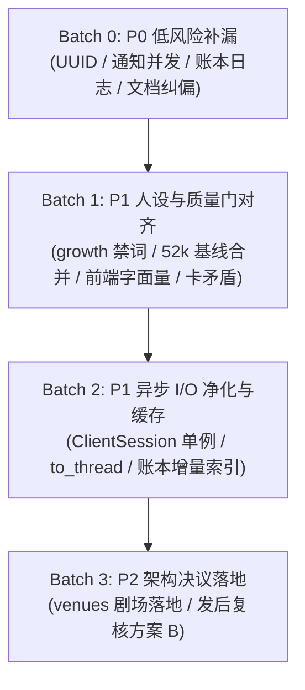

# 代码库与指导方案对齐整改与落地执行任务清单

> **文档代号**：`PLAN-2026-10-30-REMEDIATION`  
> **制定日期**：2026-10-30  
> **执行对象**：承接后续编码与重构任务的 AI Agent / 核心维护者  
> **输入依据**：  
> - [`docs/ARCHITECTURE.md`](file:///E:/myproject/BilibiliPlayer/docs/ARCHITECTURE.md)（三层架构权威说明）  
> - [`docs/analysis/2026-10-29-improvement-plan-audit.md`](file:///E:/myproject/BilibiliPlayer/docs/analysis/2026-10-29-improvement-plan-audit.md)（白皮书逐条核验与落地执行方案）  
> - [`docs/CODEBASE-IMPROVEMENT-PLAN.md`](file:///E:/myproject/BilibiliPlayer/docs/CODEBASE-IMPROVEMENT-PLAN.md)（演化白皮书议题清单）  
> - [`docs/analysis/2026-10-29-reply-dedup-fix.md`](file:///E:/myproject/BilibiliPlayer/docs/analysis/2026-10-29-reply-dedup-fix.md)（回复判重机制）  
> 
> **权威优先级**：**代码实现 > AUDIT-2026-10-29-IMPROVEMENT > 白皮书 > README.md**  
> 白皮书凡与核验方案冲突处，一律以核验方案为准。

---

## 0. 执行前置守则与质量红线

1. **测试不可红**：
   - 任何改动前后均须运行测试：`cd dsh-plugin && npm test`；
   - 当前基线为 **481 pass / 0 fail / 3 cancelled**。不得引入任何新的失败用例。
2. **批次顺序依赖**：
   - **严格按照 Batch 0 → Batch 1 → Batch 2 → Batch 3 顺序实施**；
   - Batch 0 均为独立小改动，风险极低，优先完成并单独提交；
   - Batch 1 牵涉人设卡与质量门，修改后必须同步更新单测断言并运行快照生成脚本；
   - Batch 2 集中在 `mcp_server.py` 的异步改造；
   - Batch 3 涉及架构设计决策（需遵循拍板决议）。
3. **原子化提交**：
   - 每个批次或独立 Task 完成后独立 commit，commit 信息清晰指明对应条目。

---

## 1. 批次任务全景



---

## 2. Batch 0：P0 低风险独立补漏（立即实施）

### Task 0.1 临时封面文件添加 UUID
- **目标**：防止多协程或进程截帧时因 PID 相同导致临时封面文件读写冲突。
- **文件与位置**：[`mcp_server.py#L10-L31`](file:///E:/myproject/BilibiliPlayer/mcp_server.py#L10-L31) 与 [`mcp_server.py#L1109-L1119`](file:///E:/myproject/BilibiliPlayer/mcp_server.py#L1109-L1119)
- **改法**：
  1. 在 `mcp_server.py` 头部补充导入 `import uuid`。
  2. 在 `_extract_cover_from_video` 函数中修改临时文件名生成规则：
  ```python
  # 修改前:
  tmp_cover = os.path.join(tempfile.gettempdir(), f"bili_cover_{os.getpid()}.png")
  
  # 修改后:
  tmp_cover = os.path.join(
      tempfile.gettempdir(),
      f"bili_cover_{os.getpid()}_{uuid.uuid4().hex[:8]}.png"
  )
  ```
- **验证**：运行已有测试确保无语法错误，调用截帧逻辑确保清理正常。

---

### Task 0.2 通知工具容错降级与并发获取
- **目标**：消除串行请求延迟，单侧获取失败时不使整个工具报错抛出，支持局部可用（`partial: true`）。
- **文件与位置**：[`mcp_server.py#L1895-L1915`](file:///E:/myproject/BilibiliPlayer/mcp_server.py#L1895-L1915)（`bili_received_at_and_likes`）
- **改法**：
  将串行请求替换为 `asyncio.gather(..., return_exceptions=True)` 并返回明确的局部标记：
  ```python
  @_gated_tool()
  async def bili_received_at_and_likes() -> str:
      cred = get_cred()
      result: dict = {}
      errors: list = []
      at_res, likes_res = await asyncio.gather(
          session.get_at(credential=cred),
          session.get_likes(credential=cred),
          return_exceptions=True,
      )
      for key, res in (("at", at_res), ("likes", likes_res)):
          if isinstance(res, BaseException):
              errors.append(f"{key}获取失败: {res}")
          else:
              result[key] = res
      
      payload = {"success": True, "partial": bool(errors), **result}
      if errors:
          payload["errors"] = errors
          payload["note"] = "部分通知获取失败；已有数据正常可用，缺的一半下轮再取，不要重试本调用"
      return json.dumps(payload, ensure_ascii=False)
  ```
- **验证**：检查 `duty.md` 及宿主无强依赖 `success===false` 的逆向逻辑。

---

### Task 0.3 账本读取异常日志留痕与 limit 语义修正
- **目标**：杜绝静默吞掉异常导致 `seen` 变空而引发重复看/重复回；纠正先全表解析再切片的无用 I/O。
- **文件与位置**：[`mcp_server.py#L2021-L2053`](file:///E:/myproject/BilibiliPlayer/mcp_server.py#L2021-L2053)（`_ledger_read_events`）
- **改法**：
  ```python
  def _ledger_read_events(limit: int = 0) -> list:
      out: list = []
      path = _persona_home() / "ledger.jsonl"
      try:
          if not path.exists():
              return out
          dec = json.JSONDecoder()
          bad = 0
          with open(path, encoding="utf-8") as f:
              for line in f:
                  s = line.strip()
                  if not s:
                      continue
                  i = 0
                  while i < len(s):
                      while i < len(s) and s[i] in " \t":
                          i += 1
                      if i >= len(s):
                          break
                      try:
                          obj, j = dec.raw_decode(s, i)
                      except Exception:
                          bad += 1
                          break
                      if isinstance(obj, dict):
                          out.append(obj)
                      i = j
          if bad:
              logger.warning("账本有 %d 处对象解析失败（已跳过，不影响其余对象）", bad)
      except Exception as e:
          logger.error("账本读取严重失败，返回空集（本轮判重可能失效）：%s", e)
          return out
      return out[-limit:] if limit and limit > 0 else out
  ```
- **验证**：单测覆盖坏行注入时不崩溃且有告警。

---

### Task 0.4 `mcp_server.py` 内部家目录解析统一
- **目标**：消除 Python 文件内硬编码家目录解析，统一复用 `_persona_home()`。
- **文件与位置**：[`mcp_server.py#L2586-L2590`](file:///E:/myproject/BilibiliPlayer/mcp_server.py#L2586-L2590)
- **改法**：
  ```python
  # 修改前:
  def _persona_pending_file() -> Path:
      home = os.environ.get("BILI_FENSHEN_HOME") or os.path.join(
          os.environ.get("HOME") or os.environ.get("USERPROFILE") or ".", ".dsh", "bili-fenshen")
      return Path(home) / "persona" / "growth-pending.jsonl"

  # 修改后:
  def _persona_pending_file() -> Path:
      return _persona_home() / "persona" / "growth-pending.jsonl"
  ```
- **验证**：测试 `bili_persona_note` 路径正确性。

---

### Task 0.5 清理 `ARCHITECTURE.md` 超前字段声明
- **目标**：移除文档中与实现脱节的 `commentsToVerify` 字段，避免误导开发。
- **文件与位置**：[`docs/ARCHITECTURE.md#L654`](file:///E:/myproject/BilibiliPlayer/docs/ARCHITECTURE.md#L654)
- **改法**：
  将 `| state.json | 运行态：lastRunAt/lastCode/scheduleRuns/windows/lastRunStartedAt/commentsToVerify… |` 中的 `/commentsToVerify` 删除，并标注该功能在 V1.5 重新设计中。

---

## 3. Batch 1：P1 人设系统与质量门对齐（核心功能修复）

### Task 1.1 `growth.js` 禁词表放宽与定案台词豁免
- **问题**：`growth.js:44` 硬编码 `'主人'`，误杀了 `whale.card.json` 中定案合法台词：`"主人是跟我一起用这个账号的捏"`。
- **文件与位置**：[`dsh-plugin/lib/persona/growth.js#L43-L44`](file:///E:/myproject/BilibiliPlayer/dsh-plugin/lib/persona/growth.js#L43-L44) 及 `bannedHit` 函数。
- **改法**：
  1. 剔除裸 `'主人'` 与历史遗留 `'本鲸'`，保留运营术语 `'账号主人'` 与失礼用法 `'@主人汇报'`：
     ```javascript
     const META_WORDS = ['小号', '分身', '值班', '运营', '账号主人', '@主人汇报', 'prompt', '上下文']
     ```
  2. 增加对 `card.canon` 台词的豁免保护：
     ```javascript
     const canonSay = (card) => (card?.canon || []).map((c) => String(c?.say || '')).filter(Boolean)

     const bannedHit = (text, card) => {
       const t = String(text || '')
       const low = t.toLowerCase()
       const exempt = canonSay(card).some((s) => s.includes(t) || t.includes(s))

       for (const w of META_WORDS) {
         const s = String(w || '').trim().toLowerCase()
         if (s && low.includes(s)) return exempt ? '' : s
       }
       for (const w of [...((card?.voice?.avoid?.bannedWords) || []), ...POLITICS_WORDS]) {
         const s = String(w || '').trim().toLowerCase()
         if (s && low.includes(s)) return s
       }
       return ''
     }
     ```
- **联动测试**：
  - 更新 [`dsh-plugin/test/persona.growth.test.js`](file:///E:/myproject/BilibiliPlayer/dsh-plugin/test/persona.growth.test.js) 用例；
  - 检查 [`dsh-plugin/test/fixtures/persona/smoke-card.js#L26`](file:///E:/myproject/BilibiliPlayer/dsh-plugin/test/fixtures/persona/smoke-card.js#L26) 是否包含冲突夹具。

---

### Task 1.2 合并并更新语料基线为 52,464 条实测口径
- **问题**：`lint.js` 和 `checkup.js` 各存一份 247 条老基线（中位 27 字、句号 10.9%），与已入库的 52,464 条全量语料（中位 19 字、句号 17.04%）脱节。
- **文件与位置**：
  - [`dsh-plugin/lib/persona/lint.js#L36-L43`](file:///E:/myproject/BilibiliPlayer/dsh-plugin/lib/persona/lint.js#L36-L43)
  - [`dsh-plugin/lib/persona/checkup.js#L26-L31`](file:///E:/myproject/BilibiliPlayer/dsh-plugin/lib/persona/checkup.js#L26-L31)
- **改法**：
  1. 在 `lint.js` 中更新单源基线数据（实测 charLen 口径）：
     ```javascript
     export const HUMAN_BASELINE = Object.freeze({
       comments: 52464,
       medianChars: 19,        // charLen 口径实测中位
       periodRate: 0.1704,     // 含句号的评论占比 17.04%
       questionRate: 0.0742,   // 问句率 7.42%
       emojiRate: 0.3139,      // 表情率 31.39%
       note: '52,464 条全量语料（2026-10-29，四组合并）实测：中位 19 字 / 句号 17.0% / 问句 7.4% / 表情 31.4%。',
     })
     ```
  2. 在 `checkup.js` 中直接引入并做字段名映射（避免单端定义漂移）：
     ```javascript
     import { HUMAN_BASELINE } from './lint.js'
     
     export const CHECKUP_BASELINE = Object.freeze({
       periodPerComment: HUMAN_BASELINE.periodRate,
       emojiRatio: HUMAN_BASELINE.emojiRate,
       questionRatio: HUMAN_BASELINE.questionRate,
       medianChars: HUMAN_BASELINE.medianChars,
     })
     ```
     > **口径提示**：确保 `checkup.js` 计算 `medianChars` 时统一使用 `text.js` 的 `charLen` 函数（剥离表情与空白），避免将正常表情标签误算为超长。

---

### Task 1.3 前端控制台展示字面量同步与 Smoke 断言
- **问题**：`client.js` 中体检基线数字是硬编码字面量，不修改会导致前端展示与后端计算口径分裂。
- **文件与位置**：
  - [`dsh-plugin/client.js#L2459`](file:///E:/myproject/BilibiliPlayer/dsh-plugin/client.js#L2459) 与 `L2469-L2472`
  - [`dsh-plugin/test/client.render-smoke.mjs#L438-L440`](file:///E:/myproject/BilibiliPlayer/dsh-plugin/test/client.render-smoke.mjs#L438-L440)
- **改法**：
  将 `client.js` 中硬编码的 “27字 / 41.7% / 10.9% / 12.6%” 更新为 “19字 / 31.4% / 17.0% / 7.4%”。
  同步更新 `client.render-smoke.mjs` 中的文本断言。

---

### Task 1.4 人设卡说明与配置一致性修复（句号与字数闸门）
- **问题**：
  1. [`whale.card.json#L10`](file:///E:/myproject/BilibiliPlayer/dsh-plugin/prompts/persona/whale.card.json#L10) 称 `periodMax=0`，但实际配置 `periodMaxPerComment=1`；
  2. `voice.modes.comment.maxChars` 仍为 100（过宽，未起到控制长短的作用）。
- **拍板裁决与改法**：
  1. **句号政策**：确定为“**人设风格偏好，允许最多 1 个句号，提倡无句号**”。
     - 维持 `punctuation.periodMaxPerComment: 1`；
     - 修正 `creatorNotes` 文案：“*典型 8-24 字、上限 35 字、句号至多 1 个（风格上提倡以换气和表情结句消除 AI 腔）*”；
     - 避免在提示词中宣称“真人句号率 0%”这种虚假统计。
  2. **调整评论字数闸门**：
     - 在 [`whale.card.json#L79`](file:///E:/myproject/BilibiliPlayer/dsh-plugin/prompts/persona/whale.card.json#L79)，将 `modes.comment.maxChars` 从 100 调整为 **60**（覆盖 90% 真人评论，切实收紧字数）。

---

### Task 1.5 刷新快照与全量测试验证
- **步骤**：
  1. 同步更新 [`dsh-plugin/test/persona.checkup.test.js#L41-L44`](file:///E:/myproject/BilibiliPlayer/dsh-plugin/test/persona.checkup.test.js#L41-L44) 的字面量断言；
  2. 运行快照重新生成脚本：
     ```powershell
     cd dsh-plugin
     node scripts/regen-whale-snapshot.mjs
     ```
  3. 执行全部测试：
     ```powershell
     npm test
     node test/client.render-smoke.mjs
     ```
  4. 确认所有测试 100% 通过后提交 commit。

---

## 4. Batch 2：P1 异步 I/O 净化与增量缓存（性能保障）

### Task 2.1 全局共享 `ClientSession` 单例
- **目标**：消除 `_fetch_subtitle` 每次新建/关闭 `ClientSession` 引发的重复 TLS 握手。
- **文件与位置**：[`mcp_server.py#L500-L540`](file:///E:/myproject/BilibiliPlayer/mcp_server.py#L500-L540)
- **改法**：
  ```python
  _http_session: aiohttp.ClientSession | None = None

  async def get_http_session() -> aiohttp.ClientSession:
      global _http_session
      if _http_session is None or _http_session.closed:
          _http_session = aiohttp.ClientSession(timeout=aiohttp.ClientTimeout(total=20))
      return _http_session
  ```
  在 `_fetch_subtitle` 中使用 `session = await get_http_session()`，不再使用 `async with aiohttp.ClientSession(...)`。

---

### Task 2.2 协程内部阻塞性文件 I/O 收敛至 `asyncio.to_thread`
- **目标**：将 `async def` 内的 30 处同步文件系统调用（`open` / `stat` / `mkdir` / `read_text`）收纳到独立线程中，防止事件循环卡顿。
- **关键函数**：
  - `bili_ledger_append`（[:2311-2320](file:///E:/myproject/BilibiliPlayer/mcp_server.py#L2311-L2320)）
  - `bili_report_append`（[:2363-2371](file:///E:/myproject/BilibiliPlayer/mcp_server.py#L2363-L2371)）
  - `bili_persona_note`（[:2635-2697](file:///E:/myproject/BilibiliPlayer/mcp_server.py#L2635-L2697)）
- **改法模式**：
  ```python
  def _sync_append_jsonl(path: Path, text: str) -> None:
      path.parent.mkdir(parents=True, exist_ok=True)
      with open(path, "a", encoding="utf-8", newline="\n") as f:
          f.write(text)

  # 在 async 工具中调用:
  await asyncio.to_thread(_sync_append_jsonl, path, line + "\n")
  ```

---

### Task 2.3 账本事件基于 `(size, mtime)` 的增量解析缓存
- **目标**：对齐 JS 侧 [`dsh-plugin/lib/ledger-index.js`](file:///E:/myproject/BilibiliPlayer/dsh-plugin/lib/ledger-index.js) 机制，Python 进程内多次工具调用只在文件变更时才重新解析。
- **文件与位置**：[`mcp_server.py#L2020`](file:///E:/myproject/BilibiliPlayer/mcp_server.py#L2020) 附近
- **改法**：
  ```python
  class _LedgerCache:
      def __init__(self):
          self._sig = None
          self._events: list = []

      def get_events(self) -> list:
          path = _persona_home() / "ledger.jsonl"
          try:
              st = path.stat()
          except OSError:
              return []
          sig = (st.st_size, int(st.st_mtime * 1000))
          if sig != self._sig:
              self._events = _ledger_read_events()
              self._sig = sig
          return self._events

  _ledger_cache = _LedgerCache()
  ```
  让 `_ledger_seen_bvids` 与 `_replied_targets` 内部改调 `_ledger_cache.get_events()`。

---

## 5. Batch 3：P2 关键架构决策与闭环落地

### Task 3.1 人设卡 `venues` 剧场三档分层落地
- **问题**：`whale.card.json` 中的 `venues`（普通区/生态区/AI话题区）在代码中 0 消费。
- **实施方案（落地模式）**：
  1. 在 `mcp_server.py` 的 `bili_reply` / `bili_ledger_append` 新增可选参数 `venue: str = "普通区"`；
  2. 在 `dsh-plugin/lib/persona/lint.js` 中支持按 `venue` 匹配上限：普通区 35 字、生态区 40 字、AI话题区 50 字；
  3. 在 `compile.js` 中依据 `venue` 注入对应语感段；
  4. 在 `duty.md` 章程中提示模型根据视频领域在回复时传入正确的 `venue` 参数。
- **备选方案（清理模式）**：若判定暂时不需要动态分层，则从 `whale.card.json` 中移除 `venues` 节点，并在 `creatorNotes` 标注“*暂未启用剧场分层，保持全局统一闸门*”。

---

### Task 3.2 发后复核（§2.1 抗压审）可行性实验与方案 B
- **严正警示**：**绝对不可照搬白皮书的未登录/x/v2/reply 探测方案**（未登录只返回 ~3 条，会发生 100% 误报）。
- **步骤**：
  1. **半天可行性探针实验**：
     - 用已知发布成功的评论 rpid，分别进行：
       - E1：登录态请求 `reply/main`（oid=aid）；
       - E2：无 Cookie 访客态探测；
       - E3：子评论 `reply/reply?root=...`；
     - 记录返回数据，形成简报。
  2. **若确定走方案 B（数据层独立出网核对）**：
     - 删除 `dsh-plugin/index.js` 中的 90s 死定时器和 `verifyRecentSafe`；
     - 新增独立文件 `verify-pending.jsonl`（自带 7 天轮转 TTL）；
     - `bili_reply` 尽力拿到 rpid 后写入 `verify-pending`；
     - 引入独立只读探测工具 `bili_verify_recent_comments`，带 10 分钟审核宽限窗（`grace_min=10`），不把审核中误判为压审。

---

## 6. Agent 执行验收核对总表

| 批次 | 任务项 | 负责文件 | 必测命令 | 验收标准 |
|:---:|:---|:---|:---|:---|
| **B0** | Task 0.1 临时文件 UUID | `mcp_server.py` | 静态检查 | 生成临时文件名含 8 位 hex UUID |
| **B0** | Task 0.2 通知并发容错 | `mcp_server.py` | 静态检查 | 采用 `asyncio.gather`，输出带 `partial` 标记 |
| **B0** | Task 0.3 账本读取日志 | `mcp_server.py` | 静态检查 | 异常时输出 warning/error，不再静默返回空 |
| **B0** | Task 0.4 家目录复用 | `mcp_server.py` | 静态检查 | `_persona_pending_file` 调 `_persona_home()` |
| **B0** | Task 0.5 架构文档修正 | `docs/ARCHITECTURE.md` | 文档检查 | 第 654 行移除 `commentsToVerify` |
| **B1** | Task 1.1 禁词放宽+豁免 | `growth.js` | `npm test` | 定案台词“主人是跟我一起用...”不再被拦截 |
| **B1** | Task 1.2 52k 基线合并 | `lint.js` / `checkup.js` | `npm test` | 单源引用，中位 19 字，句号 17.04% |
| **B1** | Task 1.3 前端字面量 | `client.js` | `node test/client.render-smoke.mjs` | 前端 4 处字面量与 smoke 断言同步为新基线 |
| **B1** | Task 1.4 人设卡矛盾消除 | `whale.card.json` | 静态检查 | 文档说明与执行配置一致，maxChars 降为 60 |
| **B1** | Task 1.5 刷新快照验证 | fixtures / 快照 | `npm test` | 481+ 测试全绿，快照字节级对齐 |
| **B2** | Task 2.1 Session 单例 | `mcp_server.py` | 静态检查 | 移除每次请求 new ClientSession |
| **B2** | Task 2.2 线程池读写 | `mcp_server.py` | 静态检查 | 阻塞写操作收进 `asyncio.to_thread` |
| **B2** | Task 2.3 账本缓存 | `mcp_server.py` | 静态检查 | `(size, mtime)` 命中时不重读文件 |
| **B3** | Task 3.1 venues 落地/清理 | 卡 + lint / compile | 对应测试 | 消除死代码，行为闭环 |
| **B3** | Task 3.2 发后复核 | index.js / mcp | 独立实验 | 实验先行，杜绝 100% 误报压审 |
